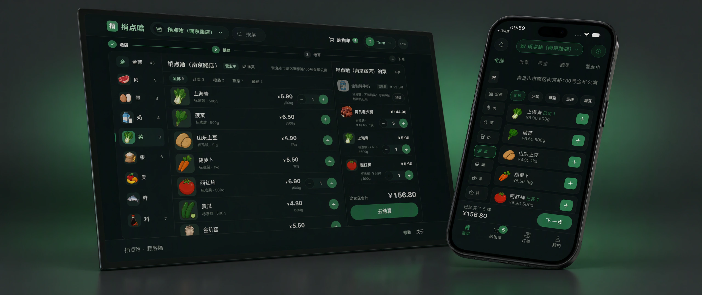

# 捎点啥

一个支持 Web 端和移动端的门店购物项目，为用户提供商品浏览、购物车、下单及门店自提等功能。

## 多端支持

- **Web 端**：通过浏览器访问，适配桌面端和移动端页面。访问地址：[https://sds.whoitao.top](https://sds.whoitao.top)。
- **Android**：提供 Android 应用。
- **iOS**：提供 iOS 应用。

## 多主题

支持浅色和深色主题，可根据使用环境切换，为不同场景提供舒适的浏览体验。

### 浅色主题

### 深色主题

