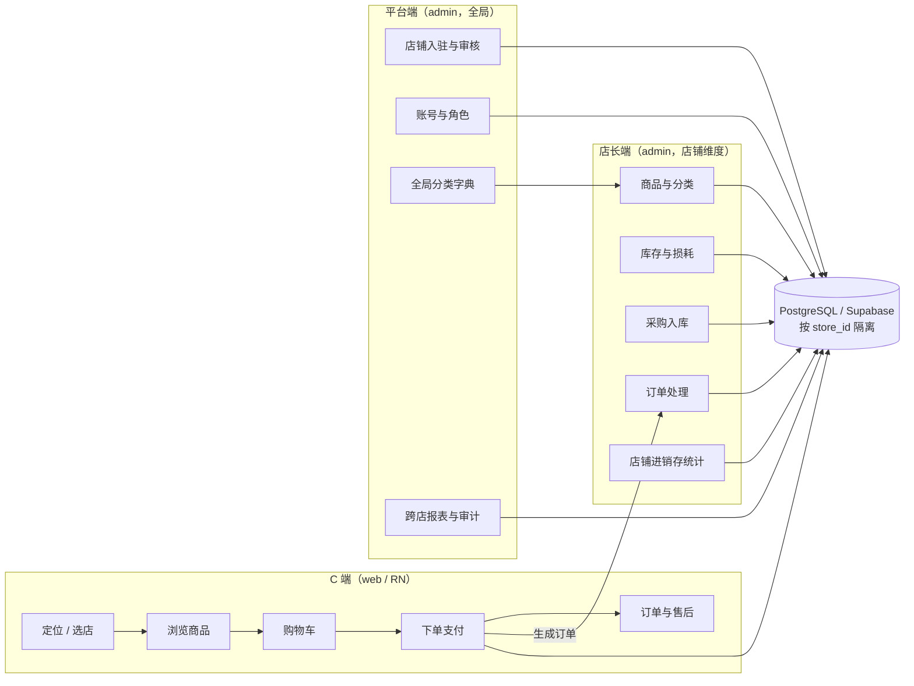
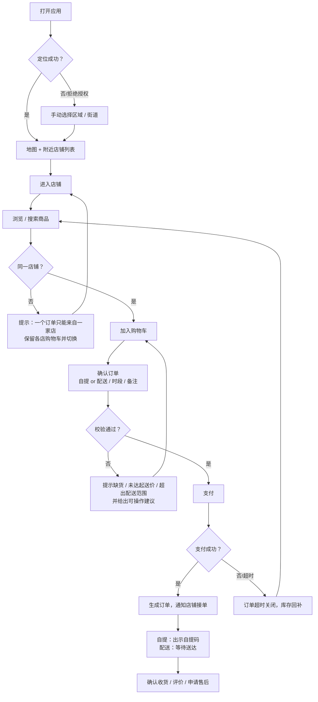
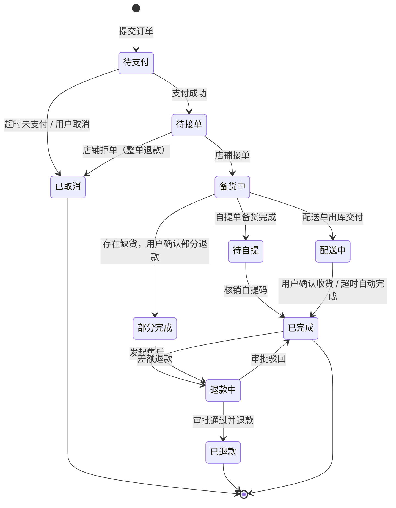
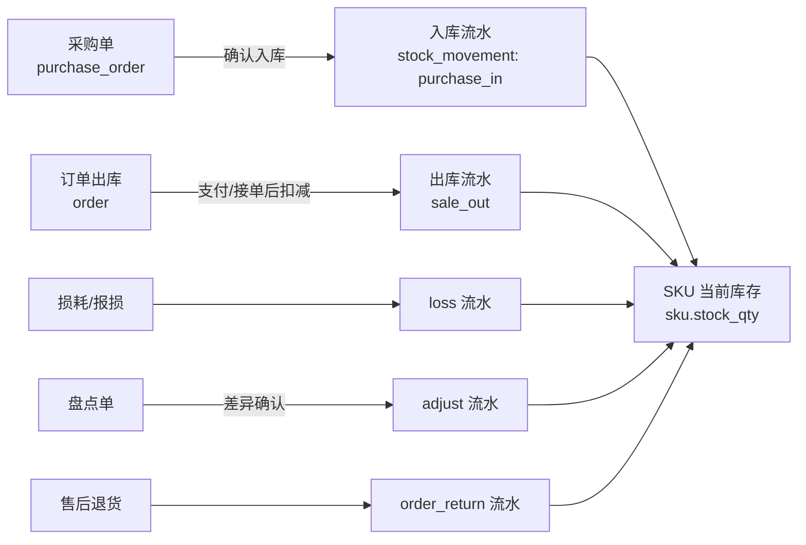
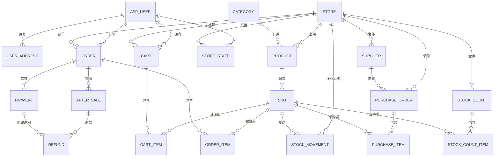
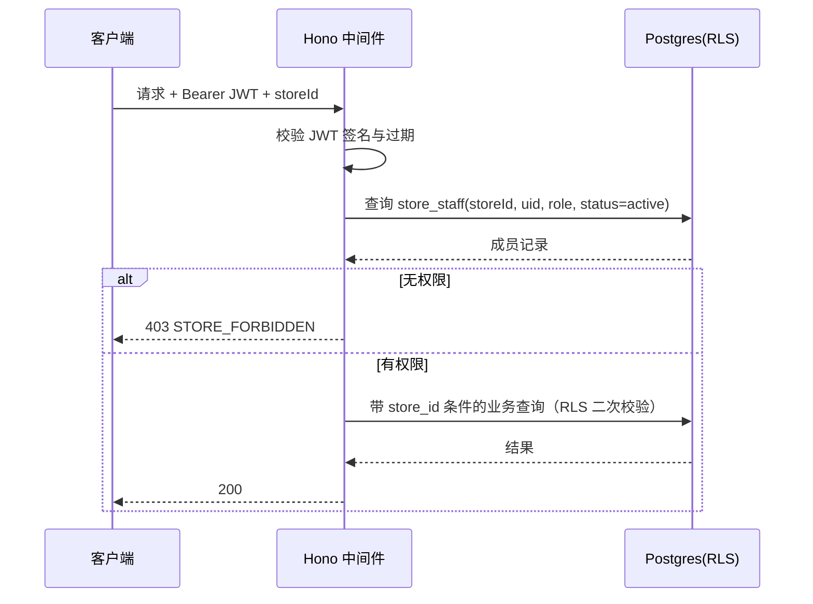
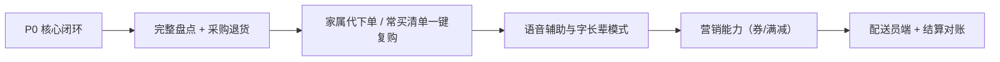

# 捎点啥（sds）产品需求文档 PRD

| 项目 | 内容 |
| --- | --- |
| 产品名称 | 捎点啥（sds） |
| 产品定位 | 面向老年人的多店铺社区买菜 / 生鲜电商系统 |
| 文档版本 | v0.1（草案） |
| 日期 | 2026-11-13 |
| 本轮范围 | 仅需求文档：不含设计图、不含代码实现、不含脚手架与数据库搭建 |
| 目标读者 | 产品、设计、前端（Next.js / RN）、后端（Hono）、测试 |

---

## 1. 背景与目标

### 1.1 问题与产品回应

```text
现状问题：老年人买菜、买米面粮油等重物，线下搬运费力；常见电商 App 层级深、
         字小、营销信息嘈杂、地图与优惠玩法复杂，老年人难以独立完成一次下单。
受影响用户与时刻：60 岁以上、居住在社区周边 1~3 公里范围内的居民，
                 在"今天要买菜 / 家里油和面快没了"的日常时刻。
产品决策：以一个城市/区域内的多家实体生鲜店铺为供给，用"附近店铺 + 大字号、
         少层级的电商流程"替代复杂的综合电商体验；店铺侧提供进销存，
         保证"线上卖的东西店里真的有"。
期望的可观察结果：老年用户在无人协助的情况下，能独立完成
     「找到附近店铺 → 挑选商品 → 下单支付 → 自提或收货」的完整闭环；
     店铺能在一套界面里管清商品的进、销、存，且线上库存与门店实物一致。
```

### 1.2 目标用户

| 用户 | 描述 | 核心诉求 | 使用端 |
| --- | --- | --- | --- |
| 老年顾客（主要） | 60 岁以上，视力与精细操作能力下降，对线上支付与地图操作不熟悉 | 字大、步骤少、别点错、能买到附近店里的东西、重物能送到家 | web / RN |
| 家属（次要） | 子女帮父母代买，或远程为父母下单 | 快速复购、地址可选父母家、能看订单进度 | web / RN |
| 店长 | 单店负责人，兼店主与管理者 | 一套界面管商品、库存、订单、进货与统计 | admin |
| 店员 / 仓管 | 店铺员工，分工处理订单与入库盘点 | 操作简单、权限受限、不误改价格 | admin |
| 平台管理员 | 平台运营方 | 管店铺入驻与账号、看全局经营数据 | admin |

### 1.3 产品目标（定性、可观察）

1. 老年用户从打开到完成支付，主流程不超过 **4 个页面层级**（首页 → 店铺 → 商品/购物车 → 下单）。
2. 关键路径（找店、加购、支付、查看订单）中，**不强制**出现双指缩放、长按、拖拽、滑动删除等精细手势。
3. 定位失败或用户拒绝授权时，用户仍能通过 **区域/街道列表** 选到店铺并完成下单，不出现死路。
4. 店铺侧任一商品的「当前库存」可由 **采购入库、销售出库、损耗、盘点调整** 四类流水完整解释，账实可对。
5. 平台可按店铺维度查看经营与库存数据，店铺之间的数据互不可见。

### 1.4 界面与视觉原则（本轮不出图）

| 原则 | 具体要求 |
| --- | --- |
| 简约清爽 | 单屏只承载一个主要任务；不做弹窗营销、不做倒计时、不做多券叠加的红点轰炸 |
| 大字号高对比 | 正文 ≥ 18px，关键信息（价格、金额、按钮）≥ 20px；按钮高度 ≥ 48px；正文对比度 ≥ 4.5:1 |
| 亲民语言 | 文案口语化，避免"SKU""履约""核销"等术语直接暴露给 C 端；按钮用动词（"加入购物车""确认下单"） |
| 浅色调 | 主色浅蓝或浅绿，背景米白/浅灰；不使用高饱和大色块与动效干扰 |
| 一屏一决策 | 支付页只保留「买了什么、多少钱、送到哪、确认支付」，其余信息折叠 |

> 详细的可达性硬性约束见 [5.1 全局规则](#51-全局规则)。

---

## 2. 角色与权限

### 2.1 角色定义

| 角色 | 标识 | 归属 | 说明 |
| --- | --- | --- | --- |
| 普通用户 | `customer` | 平台 | C 端顾客，可跨店浏览，可切换常用店铺 |
| 店长 | `store_manager` | 单店 | 单店最高权限，可管理本店商品、库存、采购、订单、员工与统计 |
| 店员 | `store_operator` | 单店 | 处理订单、维护商品信息与上下架，不可改价格、不可看采购与财务 |
| 仓管 | `store_warehouse` | 单店 | 采购入库、盘点、损耗登记，不可改售价与订单金额 |
| 平台管理员 | `platform_admin` | 平台 | 店铺入驻审核、账号与角色管理、全局分类字典、跨店报表、审计 |

> MVP 阶段平台侧只保留 `platform_admin` 一个角色；平台运营 / 财务等细分角色列入 P1（见 Q-12）。

### 2.2 权限矩阵

| 能力 | 普通用户 | 店长 | 店员 | 仓管 | 平台管理员 |
| --- | --- | --- | --- | --- | --- |
| 浏览店铺与商品 | 全部启用店铺 | 本店 | 本店 | 本店 | 全部 |
| 下单 / 支付 / 售后 | 自己 | — | — | — | — |
| 商品新建 / 编辑 / 上下架 | — | 本店 | 本店 | — | — |
| 修改售价 | — | 本店 | 禁止 | 禁止 | — |
| 库存查看 | — | 本店 | 本店 | 本店 | 全部 |
| 库存调整 / 损耗登记 | — | 本店 | — | 本店 | — |
| 采购单创建 / 入库 | — | 本店 | — | 本店 | — |
| 盘点单创建 / 确认 | — | 本店 | — | 本店 | — |
| 订单接单 / 备货 / 完成 | — | 本店 | 本店 | — | — |
| 订单取消 / 退款审批 | — | 本店 | 禁止 | — | 全部 |
| 店铺营业设置（配送范围/起送价/营业时间） | — | 本店 | — | — | 全部 |
| 店铺入驻审核 / 启停 | — | — | — | — | 全部 |
| 账号与角色授予 | — | 本店员工 | — | — | 全部 |
| 经营报表 | — | 本店 | — | — | 跨店 |

### 2.3 数据边界

- 所有店铺业务表均带 `store_id`，店长/店员/仓管的任何读写都必须命中其被授权的 `store_id`。
- 用户侧数据按 `user_id` 隔离；店铺侧只能看到与本店订单相关的收货信息，且仅限该订单履约所需字段。
- 平台管理员默认可读全部数据，但**敏感操作（退款、店铺停用、账号禁用）必须留审计日志**。

---

## 3. 核心业务模型与流程

### 3.1 系统总览



### 3.2 用户下单主流程



### 3.3 订单状态机



### 3.4 进销存模型

统一口径（店铺 × SKU × 时间区间）：

```text
期末库存 = 期初库存 + 采购入库 + 退货入库 − 销售出库 − 损耗 ± 盘点差异
```



规则要点：

1. 库存只有 `stock_movement` 一个写入口径，`sku.stock_qty` 是流水累计的结果值；两者必须可对账。
2. 成本核算采用 **移动加权平均**，入库时更新 SKU 的 `avg_cost`（[暂定，见 Q-06]）。
3. 生鲜按重商品（`is_weighed = true`）允许下单数量与实称数量不一致，差额走部分退款（见 5.2.6）。

---

## 4. 功能需求

### 4.1 全局规则

以下规则被多个模块引用，只在此处定义一次。

#### R-01 老年友好基线（硬性约束）

| 编号 | 规则 | 适用范围 |
| --- | --- | --- |
| A11Y-1 | 正文 ≥ 18px，价格与关键操作 ≥ 20px，行高 ≥ 1.6 | 全部 C 端页面 |
| A11Y-2 | 可点击区域最小 48×48px，相邻可点击元素间距 ≥ 8px | 全部 C 端页面 |
| A11Y-3 | 主流程层级 ≤ 4 层，返回按钮常驻左上角 | 全部 C 端页面 |
| A11Y-4 | 不依赖颜色单独传递信息（如"缺货"必须同时有文字） | 全部端 |
| A11Y-5 | 定位相关功能必须提供"列表选择"兜底路径 | C 端找店 |
| A11Y-6 | 支付前必须有一个"确认信息"页，金额用最大字号展示 | C 端下单 |
| A11Y-7 | 不做自动播放、不做倒计时压迫、不做遮挡式弹窗 | 全部 C 端 |
| A11Y-8 | 支持系统字号放大到 1.5 倍时不出现文字截断或按钮重叠（[待设计验证]） | C 端 |

#### R-02 购物车与店铺关系

- 一个购物车绑定一个店铺（`cart` 唯一约束 `(user_id, store_id)`）。
- 切换店铺时，原店铺购物车保留，提示"已为你保留 XX 店的购物车"。
- 一个订单只能包含一家店铺的商品；MVP **不支持跨店合并下单**（[暂定，见 Q-02]）。

#### R-03 价格与金额计算

- 金额统一以「分」为最小单位在库里存储为 `numeric(10,2)`，展示保留两位小数。
- `应付金额 = 商品金额 + 配送费 − 优惠金额`，其中配送费仅在配送单产生。
- 起送价、配送费、配送范围以**下单时店铺配置快照**为准，店铺后续修改不影响已生成订单。

#### R-04 库存扣减（详见 8.2）

- 下单提交时即校验并占用库存；支付超时（默认 15 分钟，[待确认 Q-08]）或用户取消时回补。
- 扣减采用条件更新，禁止出现负库存；并发失败时整单回滚。
- 缺货处理：备货阶段发现实物不足，由店长发起"缺货退款"，支持整单或按订单项部分退款。

#### R-05 订单幂等

- 创建订单接口要求客户端传 `Idempotency-Key`，服务端按该键去重，重复请求返回同一订单。
- 支付回调以 `(channel, external_txn_no)` 唯一约束保证只入账一次。

#### R-06 通知

| 事件 | 触达对象 | 渠道 |
| --- | --- | --- |
| 订单支付成功 | 用户、店铺 | 站内 + 短信（[待确认 Q-14]） |
| 店铺接单 / 备货完成 / 开始配送 | 用户 | 站内 |
| 订单取消、退款到账 | 用户 | 站内 |
| 库存低于安全库存 | 店长、仓管 | 站内提醒 |

#### R-07 操作审计

- 价格修改、库存调整、损耗登记、盘点确认、退款审批、店铺启停、账号禁用，均写入 `audit_log`。

### 4.2 用户端（web / RN）

#### U-01 定位与附近店铺

- **目的**：让用户在两屏内找到"能给我送/能去自提"的附近店铺。
- **入口**：应用首页。
- **布局**：
  - 上半屏：地图，店铺以大字标签标记，当前定位点用蓝色圆点。
  - 下半屏：店铺卡片列表（店铺名、距离、营业状态、起送价、配送费、自提标识、"进店"按钮）。
  - 顶部：搜索框（按店铺名或街区）。
- **处理规则**：
  1. 首次进入请求定位授权，文案说明用途（"用于查找离你最近的店铺"）。
  2. 定位成功 → 按距离升序返回 `radius` 内的启用店铺，默认 3 公里。
  3. 定位失败 / 拒绝授权 / 无结果 → 展示「选择你所在的区域」（省市区 → 街道/小区），选定后按该区域中心点查店；同时提供"打电话给我常去的店"入口（[P1]）。
  4. 用户可收藏"常去的店"，下次进入默认选中该店。
- **结果与状态**：选定店铺后写入 `app_user.default_store_id`，下次进入直接落到该店首页，同时保留"换一家"入口。
- **异常**：
  - 附近无店铺：提示"你附近暂时没有开通的店铺"，展示可切换的区域列表。
  - 店铺休息中：卡片置灰并显示"今日 8:00 营业"，仍可进店浏览但不可下单。
- **权限**：未登录用户可浏览店铺与商品，下单时再要求登录。

#### U-02 店铺切换

- 店铺首页顶部常驻"当前店铺名 + 切换"按钮，点击打开店铺列表（不跳走地图）。
- 切换后购物车不清空，按 R-02 处理。

#### U-03 商品浏览与搜索

- **分类**：左侧一级分类（蔬菜、肉禽蛋、米面粮油、奶制品、水果、日配…），右侧商品列表；分类由平台字典 + 店铺启用共同决定。
- **商品卡片**：图片、名称（≥18px）、规格、单价、单位、加减购按钮；缺货显示"已售完"并禁用加购。
- **搜索**：店内搜索，支持按商品名与别名（如"洋芋/土豆"，[P1]）；无结果时给出"换个词试试"与推荐分类。
- **常买清单**：按用户近 90 天购买频次排序，支持"一键把常买的都加进购物车"（[P1]）。

#### U-04 购物车

- 展示：店铺名、商品行（可改数量、可删）、合计金额、是否达起送价、"去结算"。
- 规则：
  - 数量增减用大号 `−` / `+` 按钮，步长 1；按重商品步长 0.5（[待确认 Q-07]）。
  - 库存不足时在行内提示"仅剩 X 份"，并把数量收敛到可用上限。
  - 未达起送价时，"去结算"置灰并提示"还差 X 元起送"。
- 空态：展示"购物车还是空的"与"去逛逛"按钮。
- 持久化：登录用户购物车存服务端；未登录用户购物车存本地，登录后合并（同 SKU 取较大数量，[暂定]）。

#### U-05 下单与履约

- **履约方式**：自提 / 配送，二选一，用两个大卡片呈现，默认选中上次使用的方式。
- **配送**：
  - 地址簿选择（收货人、电话、详细地址），可新增；默认地址优先。
  - 校验地址是否在店铺配送范围内，超出则提示"该地址超出配送范围，可改为自提"。
  - 期望送达时段：按店铺配置的可选时段（如"今天 15:00-17:00"），不做精确到分钟的承诺。
- **自提**：
  - 展示自提点地址、营业时间、联系电话。
  - 生成自提码（4 位数字 + 二维码），订单详情常驻展示。
- **确认页**：店名、商品清单、金额明细（大字）、履约方式、收货信息、备注；底部固定"提交订单"。
- **异常**：提交时库存变化 → 明确告知哪几件商品库存不足，并提供"移除这些商品继续下单"。

#### U-06 支付与订单

- **支付方式**：微信支付 / 支付宝 / 货到付款（[待确认 Q-01]），按店铺配置开放。
- **支付页**：只展示金额、订单号、倒计时（弱化，不闪烁）、支付按钮；支付成功后跳订单详情。
- **订单列表**：按状态分组（待支付 / 进行中 / 已完成），卡片展示店铺名、缩略图、金额、状态、主操作按钮（去支付 / 查看自提码 / 再来一单 / 申请售后）。
- **订单详情**：状态时间轴、商品明细、金额明细、履约信息、店铺电话（可一键拨打）、售后入口。
- **取消**：待支付可直接取消；待接单可申请取消（需店铺同意或自动同意，[待确认 Q-09]）。

#### U-07 售后

- **可申请范围**：已完成订单在 N 天内（[待确认 Q-10]）；缺货、少件、品质问题、称重差异。
- **提交**：选择订单项（可多选）、原因、描述、最多 3 张图片、期望处理方式（仅退款 / 退货退款）。
- **处理**：店铺审批 → 同意则原路退款 → 状态回写订单；驳回需填原因。
- **状态**：`待处理 → 已同意/已驳回 → 已退款`；用户在详情可见进度。

### 4.3 店长端（admin，店铺维度）

> 店长端与平台端共用 admin 应用，通过店铺选择器进入"当前店铺"上下文，所有页面左上角显示当前店铺名，避免误操作到别家店。

#### M-01 店铺设置

- 字段：店铺名、联系电话、地址（地图选点）、营业时间（按周配置）、自提开关、配送开关、配送半径、起送价、配送费、可预约时段、店铺公告。
- 规则：修改立即生效于新订单；配送半径与起送价的变更需二次确认。
- 权限：仅店长与平台管理员。

#### M-02 商品与分类

- **分类**：从平台字典勾选本店启用的分类，可排序，可设本店自定义分类（[P1]）。
- **商品（SPU）**：名称、分类、单位（份/斤/袋/箱）、是否按重、主图、描述、排序、状态（草稿/上架/下架）。
- **规格（SKU）**：规格名（如"500g/袋"）、条码、售价、库存、安全库存、状态。
- **批量操作**：批量上下架、批量改价（按分类或按比例，需二次确认并记审计）。
- **校验**：上架商品至少 1 个可用 SKU 且售价 > 0；删除商品改为下架（软删除）。

#### M-03 库存与损耗

- 库存列表：按分类/关键词筛选，展示当前库存、安全库存、近 7 天销量，低于安全库存高亮。
- 库存调整：仅允许"盘盈/盘亏/损耗"三类原因，填写数量与备注，生成 `adjust` 或 `loss` 流水。
- 损耗登记：选择 SKU、数量、原因（过期/破损/品质/其他）、照片（可选）。
- 规则：任何调整都不能让库存变为负数；每次调整展示"调整前 → 调整后"。

#### M-04 采购入库

- **供应商**：名称、联系人、电话、备注。
- **采购单**：选择供应商 → 添加 SKU 与数量、进价 → 保存草稿 / 提交 → 收货时逐项确认实收数量与实收单价 → 确认入库。
- **入库结果**：按实收数量生成 `purchase_in` 流水，更新库存与移动加权成本；差异（少收/多收）必须填写原因。
- **状态**：`草稿 → 已提交 → 已入库 / 已取消`；已入库不可编辑，只能通过退货或调整修正（[P1 采购退货]）。

#### M-05 盘点

- **盘点单**：选择分类或全店 → 生成账面快照 → 录入实盘数量 → 提交差异 → 确认后生成 `adjust` 流水。
- **MVP 简化**：先支持"按 SKU 直接调整"；完整盘点单（含盘点快照、多人分工、差异复核）为 P1（[见 9.2]）。

#### M-06 订单处理

- **列表**：按状态分组（待接单 / 备货中 / 待自提 / 配送中 / 售后），支持按订单号、手机号后四位搜索。
- **接单**：一键接单；拒单必须选择原因并自动整单退款。
- **备货**：可逐项勾选已备货；发现缺货可发起缺货退款（整单或按项）。
- **自提核销**：输入 4 位自提码或扫码核销，核销后订单完成。
- **配送**：标记"开始配送"与"已送达"；配送员信息 MVP 不建账号（[见 Q-04]）。
- **售后处理**：查看申请、图片、订单项，同意/驳回并填写处理说明。
- **打印**：支持打印拣货单 / 小票（[P1]）。

#### M-07 店铺进销存统计

| 报表 | 指标 | 维度 |
| --- | --- | --- |
| 销售 | 订单数、销售额、客单价、退款额、退款率 | 日/周/月、分类、SKU |
| 采购 | 采购额、入库量、供应商占比 | 日/周/月、供应商、分类 |
| 库存 | 当前库存量、库存金额、低于安全库存 SKU 数、周转天数 | 分类、SKU |
| 损耗 | 损耗量、损耗金额、损耗率 | 日/周/月、原因 |
| 毛利 | 销售额 − 销货成本（移动加权） | 日/周/月、分类 |

- 口径说明必须展示在页面上（"毛利按移动加权成本计算，不含配送费"），避免店长误解。
- 数据延迟：MVP 允许 T+0 实时聚合查询，若性能不足再加日汇总表（[P1]）。

### 4.4 平台端（admin，全局）

#### A-01 店铺管理

- 列表：店铺名、编码、所在城市/区域、店长、状态、近 30 天订单数、GMV。
- 新建：店铺基础信息 + 地图选点 + 指定店长账号。
- 审核：`待审核 → 启用 / 驳回`；启用后 C 端可见。资质材料上传为 P1（[Q-05]）。
- 停用：C 端立即不可下单，进行中订单需人工处理；操作必须填原因并记审计。

#### A-02 账号与角色

- 平台账号与店铺员工账号统一在 `app_user` + `store_staff` 中管理。
- 支持：新建店长账号、把已有用户指派为某店店员/仓管、禁用账号、重置登录方式。
- 规则：一个用户可以在多家店担任不同角色（数据上允许，UI 上需明确提示）；禁用账号立即失效其所有店铺权限。

#### A-03 全局分类字典

- 维护一级/二级分类（名称、图标、排序、是否启用），供全部店铺勾选。
- 删除分类前需检查是否有店铺在用，有则禁止删除只允许停用。

#### A-04 跨店报表与审计

- 概览：店铺数、活跃店铺、订单量、GMV、退款率、按店铺排行。
- 明细：可按店铺、时间、分类下钻。
- 审计日志：按操作人、资源类型、时间检索，只读不可删。

---

## 5. 数据模型草案

> 以下为 PostgreSQL（Supabase）表结构草案，用于对齐字段与约束，**不是最终迁移脚本**。所有表默认含 `created_at`、`updated_at`；金额 `numeric(10,2)`；数量 `numeric(12,3)`（兼容按重商品）。

### 5.1 ER 关系



### 5.2 表清单与关键字段

#### 用户与地址

| 表 | 关键字段 | 唯一约束 / 索引要点 |
| --- | --- | --- |
| `app_user` | `id uuid PK`（对应 Supabase Auth 用户）、`phone`、`nickname`、`avatar_url`、`default_store_id`、`status`（active/disabled）、`last_login_at` | `UNIQUE(phone)`；`INDEX(default_store_id)` |
| `user_address` | `id`、`user_id`、`receiver_name`、`receiver_phone`、`province`、`city`、`district`、`detail`、`location geography(Point,4326)`、`is_default`、`tag`（家/子女家） | `INDEX(user_id)`；部分唯一索引 `UNIQUE(user_id) WHERE is_default`；`GIST(location)` |

#### 店铺与人员

| 表 | 关键字段 | 唯一约束 / 索引要点 |
| --- | --- | --- |
| `store` | `id`、`code`、`name`、`owner_user_id`、`phone`、`province/city/district`、`address`、`location geography(Point,4326)`、`business_hours jsonb`、`pickup_enabled`、`delivery_enabled`、`delivery_radius_m`、`min_order_amount`、`delivery_fee`、`status`（pending/active/suspended/closed） | `UNIQUE(code)`；`GIST(location)`；`INDEX(city, status)` |
| `store_staff` | `id`、`store_id`、`user_id`、`role`（manager/operator/warehouse）、`status` | `UNIQUE(store_id, user_id)`；`INDEX(user_id)` |

#### 商品与库存

| 表 | 关键字段 | 唯一约束 / 索引要点 |
| --- | --- | --- |
| `category` | `id`、`parent_id`、`name`、`icon`、`sort`、`status` | `UNIQUE(parent_id, name)` |
| `product` | `id`、`store_id`、`category_id`、`name`、`subtitle`、`description`、`main_image`、`images jsonb`、`unit`、`is_weighed`、`status`（draft/on_sale/off_sale）、`sort` | `INDEX(store_id, status, category_id)`；`INDEX(store_id, name)` |
| `sku` | `id`、`product_id`、`store_id`（冗余，便于隔离与聚合）、`spec_name`、`barcode`、`price`、`original_price`、`stock_qty`、`safety_stock`、`avg_cost`、`status` | `UNIQUE(product_id, spec_name)`；`INDEX(store_id, status)`；`CHECK(stock_qty >= 0)` |
| `supplier` | `id`、`store_id`、`name`、`contact_name`、`phone`、`status`、`remark` | `INDEX(store_id, status)` |

#### 采购、流水与盘点

| 表 | 关键字段 | 唯一约束 / 索引要点 |
| --- | --- | --- |
| `purchase_order` | `id`、`store_id`、`po_no`、`supplier_id`、`status`（draft/submitted/received/cancelled）、`total_amount`、`expected_at`、`received_at`、`created_by`、`remark` | `UNIQUE(po_no)`；`INDEX(store_id, status, created_at)` |
| `purchase_order_item` | `id`、`purchase_order_id`、`sku_id`、`qty`、`unit_cost`、`received_qty`、`amount` | `UNIQUE(purchase_order_id, sku_id)` |
| `stock_movement` | `id`、`store_id`、`sku_id`、`biz_type`（purchase_in/sale_out/order_return/adjust/loss/transfer_in/transfer_out）、`qty_delta`（正入负出）、`stock_after`、`unit_cost`、`ref_type`、`ref_id`、`operator_id`、`remark` | `UNIQUE(ref_type, ref_id, sku_id, biz_type)`（幂等）；`INDEX(store_id, sku_id, created_at)`；`INDEX(store_id, biz_type, created_at)` |
| `stock_count` | `id`、`store_id`、`count_no`、`status`（draft/counting/confirmed/cancelled）、`counted_by`、`confirmed_at`、`remark` | `UNIQUE(count_no)`；`INDEX(store_id, status, created_at)` |
| `stock_count_item` | `id`、`stock_count_id`、`sku_id`、`book_qty`、`actual_qty`、`diff_qty`、`unit_cost` | `UNIQUE(stock_count_id, sku_id)` |

#### 交易

| 表 | 关键字段 | 唯一约束 / 索引要点 |
| --- | --- | --- |
| `cart` | `id`、`user_id`、`store_id` | `UNIQUE(user_id, store_id)` |
| `cart_item` | `id`、`cart_id`、`sku_id`、`qty` | `UNIQUE(cart_id, sku_id)`；`CHECK(qty > 0)` |
| `order` | `id`、`order_no`、`user_id`、`store_id`、`fulfillment_type`（pickup/delivery）、`status`、`item_amount`、`delivery_fee`、`discount_amount`、`payable_amount`、`paid_amount`、`receiver_name`、`receiver_phone`、`address_detail`、`address_location`、`pickup_code`、`expected_time`、`remark`、`paid_at`、`cancelled_at`、`cancel_reason` | `UNIQUE(order_no)`；`INDEX(store_id, status, created_at)`；`INDEX(user_id, created_at)`；`INDEX(pickup_code) WHERE status = 'ready_for_pickup'` |
| `order_item` | `id`、`order_id`、`sku_id`、`product_name`（快照）、`spec_name`、`unit`、`unit_price`（快照）、`qty`、`actual_qty`、`amount`、`is_weighed` | `INDEX(order_id)`；`INDEX(sku_id)` |
| `payment` | `id`、`order_id`、`channel`（wechat/alipay/cash/balance）、`amount`、`status`（created/pending/success/failed/closed）、`external_txn_no`、`idempotency_key`、`paid_at`、`raw jsonb` | `UNIQUE(idempotency_key)`；`UNIQUE(channel, external_txn_no)`；`INDEX(order_id)` |
| `after_sale` | `id`、`after_sale_no`、`order_id`、`order_item_id`、`user_id`、`store_id`、`type`（refund_only/return_refund）、`reason_type`、`description`、`images jsonb`、`amount`、`status`（applied/approved/rejected/refunded/closed）、`handled_by`、`handled_at` | `UNIQUE(after_sale_no)`；`INDEX(store_id, status)`；`INDEX(order_id)` |
| `refund` | `id`、`after_sale_id`、`payment_id`、`amount`、`channel_refund_no`、`status`、`refunded_at` | `UNIQUE(channel_refund_no)`；`INDEX(after_sale_id)` |
| `audit_log` | `id`、`actor_id`、`actor_role`、`store_id`、`action`、`resource_type`、`resource_id`、`before jsonb`、`after jsonb`、`ip` | `INDEX(store_id, created_at)`；`INDEX(actor_id, created_at)` |

### 5.3 关键约束说明

1. **快照字段**：`order_item` 必须冗余商品名、规格、单价、单位，避免商品改价后历史订单金额被改写。
2. **金额一致性**：`order.payable_amount = item_amount + delivery_fee − discount_amount`，由服务端计算，禁止客户端传值。
3. **库存非负**：`sku.stock_qty >= 0` 作为兜底约束，业务层用条件更新先判断。
4. **幂等**：`stock_movement` 的 `(ref_type, ref_id, sku_id, biz_type)` 唯一约束保证同一订单/采购单不会重复扣增库存。
5. **软删除**：商品、店铺、账号不做物理删除，使用状态字段；审计日志永久保留。

### 5.4 多店铺数据隔离

- 所有店铺业务表带 `store_id`，并在 Supabase 启用 **RLS**：
  - `store_staff` 中 `user_id = auth.uid()` 且 `status = 'active'` 才可读写对应 `store_id`。
  - `customer` 只能读写 `user_id = auth.uid()` 的行（`cart`、`order`、`user_address`）。
  - 平台管理员通过 JWT 中的 `role` 声明放行。
- 服务端（Hono）同时做一次强制校验，RLS 作为第二道防线，不依赖单一层。

---

## 6. API 规划草案

### 6.1 通用约定

| 项 | 约定 |
| --- | --- |
| 前缀 | `/api/v1` |
| 认证 | Supabase Auth 签发的 JWT，`Authorization: Bearer <token>` |
| 角色声明 | JWT `app_metadata.platform_role`（platform_admin）；店铺角色走 `store_staff` 表实时查询，避免改权限需重新登录 |
| 店铺上下文 | 店长端路径显式带 `storeId`，中间件校验 `store_staff` 中存在 `(storeId, uid, role)` 且状态为 active |
| 分页 | `?page=1&pageSize=20`，响应 `{ items, page, pageSize, total }` |
| 错误 | `{ code, message, details? }`，HTTP 状态码语义化；业务错误码如 `OUT_OF_STOCK`、`STORE_CLOSED` |
| 幂等 | 写操作支持 `Idempotency-Key` 头，MVP 强制用于 `POST /orders` 与支付回调 |
| 时间 | ISO 8601，服务端 UTC 存储，前端按本地时区展示 |

### 6.2 用户端（web / RN 共用）

| 方法 | 路径 | 用途 |
| --- | --- | --- |
| POST | `/auth/otp/send` | 发送手机验证码（MVP 直接用 Supabase SDK 亦可） |
| POST | `/auth/otp/verify` | 校验并换取会话 |
| GET | `/me` | 当前用户资料与默认店铺 |
| PATCH | `/me` | 修改昵称、默认店铺 |
| GET | `/stores/nearby?lat=&lng=&radius=&keyword=` | 附近店铺（返回距离、营业状态） |
| GET | `/stores?district=&page=` | 无定位时的区域店铺列表（兜底） |
| GET | `/stores/{storeId}` | 店铺详情与营业状态 |
| GET | `/stores/{storeId}/categories` | 本店启用的分类 |
| GET | `/stores/{storeId}/products?categoryId=&keyword=&page=` | 商品列表 |
| GET | `/skus/{skuId}` | 商品与 SKU 详情 |
| GET | `/stores/{storeId}/cart` | 获取该店购物车 |
| POST | `/stores/{storeId}/cart/items` | 加入购物车 |
| PATCH | `/cart/items/{itemId}` | 改数量 |
| DELETE | `/cart/items/{itemId}` | 删除条目 |
| GET | `/addresses` | 地址列表 |
| POST | `/addresses` | 新增地址 |
| PATCH | `/addresses/{id}` | 修改地址 |
| DELETE | `/addresses/{id}` | 删除地址 |
| POST | `/orders` | 提交订单（校验库存、起送价、配送范围，事务内扣减） |
| GET | `/orders?status=&page=` | 订单列表 |
| GET | `/orders/{orderNo}` | 订单详情（含自提码、时间轴） |
| POST | `/orders/{orderNo}/cancel` | 取消订单 |
| POST | `/orders/{orderNo}/pay` | 创建支付单并返回支付参数 |
| POST | `/payments/callback/{channel}` | 支付回调（验签 + 幂等入账） |
| POST | `/orders/{orderNo}/after-sales` | 申请售后 |
| GET | `/after-sales?page=` | 售后列表 |
| GET | `/after-sales/{id}` | 售后详情 |

### 6.3 店长端

| 方法 | 路径 | 用途 |
| --- | --- | --- |
| GET | `/merchant/stores` | 我可管理的店铺列表（多店时选择上下文） |
| GET | `/merchant/stores/{storeId}` | 店铺详情与设置 |
| PATCH | `/merchant/stores/{storeId}` | 修改营业时间、配送范围、起送价等 |
| GET | `/merchant/stores/{storeId}/categories` | 可选与已启用分类 |
| PUT | `/merchant/stores/{storeId}/categories` | 设置启用分类与排序 |
| GET | `/merchant/stores/{storeId}/products` | 商品列表（含下架） |
| POST | `/merchant/stores/{storeId}/products` | 新建商品 |
| PATCH | `/merchant/products/{productId}` | 编辑商品 |
| PATCH | `/merchant/products/{productId}/status` | 上架 / 下架 |
| POST | `/merchant/products/{productId}/skus` | 新增规格 |
| PATCH | `/merchant/skus/{skuId}` | 改规格、售价、安全库存 |
| POST | `/merchant/products/batch-price` | 批量改价（记审计） |
| GET | `/merchant/stores/{storeId}/inventory` | 库存列表（含低库存筛选） |
| POST | `/merchant/stores/{storeId}/stock-movements` | 库存调整 / 损耗登记 |
| GET | `/merchant/stores/{storeId}/stock-movements` | 库存流水查询 |
| GET | `/merchant/stores/{storeId}/suppliers` | 供应商列表 |
| POST | `/merchant/stores/{storeId}/suppliers` | 新增供应商 |
| GET | `/merchant/stores/{storeId}/purchase-orders` | 采购单列表 |
| POST | `/merchant/stores/{storeId}/purchase-orders` | 创建采购单 |
| PATCH | `/merchant/purchase-orders/{id}` | 编辑草稿 |
| POST | `/merchant/purchase-orders/{id}/receive` | 确认入库（生成流水） |
| POST | `/merchant/purchase-orders/{id}/cancel` | 取消采购单 |
| GET | `/merchant/stores/{storeId}/stock-counts` | 盘点单列表 |
| POST | `/merchant/stores/{storeId}/stock-counts` | 创建盘点单 |
| POST | `/merchant/stock-counts/{id}/confirm` | 确认盘点差异 |
| GET | `/merchant/stores/{storeId}/orders?status=` | 订单列表 |
| POST | `/merchant/orders/{orderNo}/accept` | 接单 |
| POST | `/merchant/orders/{orderNo}/reject` | 拒单（触发退款） |
| POST | `/merchant/orders/{orderNo}/prepare` | 备货完成 |
| POST | `/merchant/orders/{orderNo}/pickup-verify` | 自提核销 |
| POST | `/merchant/orders/{orderNo}/deliver` | 开始配送 / 已送达 |
| POST | `/merchant/after-sales/{id}/approve` | 售后同意 |
| POST | `/merchant/after-sales/{id}/reject` | 售后驳回 |
| GET | `/merchant/stores/{storeId}/reports/sales` | 销售报表 |
| GET | `/merchant/stores/{storeId}/reports/inventory` | 库存报表 |
| GET | `/merchant/stores/{storeId}/reports/purchase` | 采购报表 |
| GET | `/merchant/stores/{storeId}/reports/profit` | 毛利报表 |

### 6.4 平台端

| 方法 | 路径 | 用途 |
| --- | --- | --- |
| GET | `/admin/stores?city=&status=&page=` | 店铺列表 |
| POST | `/admin/stores` | 新建店铺并指定店长 |
| PATCH | `/admin/stores/{id}` | 编辑店铺信息 |
| POST | `/admin/stores/{id}/approve` | 审核通过（启用） |
| POST | `/admin/stores/{id}/reject` | 审核驳回 |
| POST | `/admin/stores/{id}/suspend` | 停用（需填原因） |
| GET | `/admin/users?keyword=&page=` | 用户列表 |
| POST | `/admin/users` | 创建账号 |
| PATCH | `/admin/users/{id}/status` | 启用 / 禁用 |
| POST | `/admin/users/{id}/store-roles` | 指派店铺角色 |
| DELETE | `/admin/users/{id}/store-roles/{roleId}` | 解除店铺角色 |
| GET | `/admin/categories` | 分类字典 |
| POST | `/admin/categories` | 新建分类 |
| PATCH | `/admin/categories/{id}` | 编辑 / 停用分类 |
| GET | `/admin/reports/overview` | 全局概览 |
| GET | `/admin/reports/stores` | 店铺对比报表 |
| GET | `/admin/audit-logs?actorId=&resourceType=` | 审计日志 |

### 6.5 鉴权与隔离实现要点



- 店长/店员/仓管的权限差异由中间件按 `role` 做能力校验（如 `warehouse` 禁止 `PATCH /merchant/skus/{id}` 改价）。
- 平台管理员接口校验 `app_metadata.platform_role = 'platform_admin'`，并写审计。
- 服务端使用 service role 仅限系统任务（超时关单、库存回补），且必须在代码中显式限定 `store_id`。

---

## 7. 非功能需求与约束

| 类别 | 要求 |
| --- | --- |
| 多店铺隔离 | 所有店铺数据必须带 `store_id`；Hono 中间件 + Supabase RLS 双层校验；任何跨店聚合只允许平台管理员接口 |
| 库存并发 | 单一 SKU 扣减使用 `UPDATE sku SET stock_qty = stock_qty - $1 WHERE id = $2 AND stock_qty >= $1 RETURNING stock_qty`；影响行数为 0 视为库存不足并回滚整单；多 SKU 按 `sku_id` 升序加锁避免死锁 |
| 订单幂等 | `POST /orders` 依赖 `Idempotency-Key`；支付回调依赖 `(channel, external_txn_no)` 唯一约束；库存流水依赖唯一约束防重复 |
| 地理检索 | MVP 采用 PostGIS `geography(Point,4326)` + `ST_DWithin` + `ST_Distance` 排序；若部署环境不支持 PostGIS，退化为"经纬度包围盒预筛 + 应用层 haversine 排序"（精度足够，索引效率略低）。取舍理由：店铺数量在单城市量级（数百），PostGIS 收益主要在正确性与用不上的复杂空间分析，MVP 可用包围盒，但**建议直接上 PostGIS** 以免后期迁移 |
| 性能 | 商品列表与订单列表首屏 P95 < 1.5s（4G 网络）；店铺附近查询 P95 < 300ms |
| 可用性 | 下单、支付回调、库存扣减为核心链路，任一不可用需有明确失败提示与重试；支付回调必须幂等且可重放 |
| 一致性 | 订单与库存扣减在同一数据库事务内；退款与库存回补分两步，允许最终一致，但必须有对账任务（[P1]） |
| 安全 | 手机号等个人信息不在前端日志输出；管理端强制二次确认高风险操作；所有金额由服务端计算 |
| 兼容性 | web 支持近两年主流浏览器；RN 支持 iOS 14+ / Android 8+；C 端页面在 320px 宽度下不横向滚动 |
| 可访问性 | 满足 4.1 R-01 全部硬性约束；关键图标均带文字标签 |
| 可观测性 | 订单、支付、库存变动需有结构化日志与 traceId，便于按订单号排查 |

---

## 8. MVP 范围与分期

### 8.1 P0（第一版必须做）

| 模块 | 范围 |
| --- | --- |
| 找店 | 地图 + 附近店铺列表 + 区域列表兜底 + 收藏常去店铺 |
| 商品 | 分类浏览、店内搜索、SKU 加购、缺货置灰 |
| 购物车 | 单店购物车、多店购物车并行保留、起送价校验 |
| 下单 | 自提 / 配送、地址簿、配送范围校验、库存占用、幂等 |
| 支付 | 微信支付（或按 Q-01 结论）+ 支付回调幂等 + 超时关单回补 |
| 订单 | 六态主干流程、自提码核销、取消、店铺接单/拒单/备货 |
| 售后 | 仅退款与缺货退款，店铺审批，原路退回 |
| 店铺商品 | SPU/SKU 管理、上下架、改价、安全库存 |
| 库存 | 采购单 + 入库、损耗/调整、库存流水 |
| 店铺报表 | 销售、库存、损耗、毛利（基础版） |
| 平台 | 店铺新建与启停、账号与店铺角色、全局分类、概览报表、审计日志 |

### 8.2 暂不做（明确排除，避免误解）

| 项 | 原因 / 归属 |
| --- | --- |
| 完整盘点单（快照、多方复核、差异审批流） | MVP 先用"按 SKU 调整"过渡，P1 补齐 |
| 跨店合并下单、跨店凑单优惠 | 履约与结算复杂度高，P1 再评估 |
| 优惠券、满减、会员积分、拼团 | 老年用户认知负担大，且非核心闭环 |
| 配送员端 App、路径规划 | MVP 由店铺自行配送，仅标记状态 |
| 供应商端与采购对账、账期结算 | P1 |
| 平台抽佣与店铺结算打款 | 涉及资金合规，需单独设计 |
| 语音搜索、语音播报、图片搜索 | P1 可达性增强 |
| 商品评价与晒单 | P1 |
| 多城市运营与城市级调度 | MVP 单城市/单区域 |
| 微信小程序端 | 需评估是否替代 RN（Q-13） |
| 发票、电子小票打印 | P1 |
| 资质材料上传与自动审核 | P1，MVP 走人工 |

### 8.3 P1 建议顺序



---

## 9. 待确认问题清单

> 以下决策会影响权限、资金流或核心流程，**不由本文档代替决定**，请逐条拍板。文档中凡标 `[暂定]` 的地方均对应下列问题。

| ID | 问题 | 影响 | 可选方向 |
| --- | --- | --- | --- |
| Q-01 | C 端支持哪些支付方式？是否必须支持「货到付款」？ | 支付模块、退款链路、对账 | 仅微信 / 微信+支付宝 / 增加货到付款 |
| Q-02 | 是否允许跨店合并下单？ | 购物车模型、配送费与结算逻辑 | 单店单（本文暂定）/ 跨店合并 |
| Q-03 | 配送由谁执行？ | 是否需要配送员账号、履约时效承诺 | 店铺自配送 / 平台众包 / 第三方 |
| Q-04 | 店长是否需要移动端（RN）处理订单？ | RN 端范围翻倍、MVP 工期 | 仅 admin web / 增加店长 App |
| Q-05 | 店铺入驻是否需要资质审核（食品经营许可证等）？ | 平台审核流程、合规风险 | MVP 人工线下审核 / 线上材料上传 |
| Q-06 | 销货成本核算方式？ | 毛利口径 | 移动加权平均（本文暂定）/ 先进先出 / 不核算 |
| Q-07 | 生鲜按重商品的计价与下单方式？ | 商品模型、部分退款 | 按份固定重量 / 按斤估算后实称补退差 |
| Q-08 | 待支付订单的超时时长？ | 库存占用时长与转化率 | 15 分钟（本文暂定）/ 5 分钟 / 30 分钟 |
| Q-09 | 待接单状态下用户申请取消，是否需要店铺同意？ | 取消流程、用户体验 | 自动同意 / 店铺审批 / 超时自动同意 |
| Q-10 | 售后申请的有效期？ | 售后入口、店铺责任边界 | 收货后 24 小时 / 7 天 / 仅当日 |
| Q-11 | 平台是否抽佣？如何与店铺结算？ | 资金合规、结算系统是否进 MVP | 不抽佣 MVP / 抽佣并 T+1 结算 |
| Q-12 | 平台侧是否需要细分角色（运营、客服、财务）？ | 权限模型复杂度 | MVP 单一管理员 / 细分角色 |
| Q-13 | 移动端是否必须用 RN？是否需要微信小程序？ | 技术选型与老年人触达 | 仅 RN / RN + 小程序 / 仅小程序 |
| Q-14 | 订单通知是否发短信？成本与到达率如何权衡？ | 通知渠道与成本 | 仅站内 / 站内+短信 / 站内+电话外呼 |
| Q-15 | 首版覆盖范围（城市/区域/店铺数量）？ | 地图检索方案、性能基线 | 单城市单区（本文暂定）/ 单城市多区 |
| Q-16 | 是否支持「家属代父母下单」的家庭账号？ | 账号模型、地址与支付归属 | 不做 / 共享登录 / 家庭组 |

---

## 10. 附录：术语表

| 术语 | 含义 |
| --- | --- |
| SPU | 商品（同一商品的统称，如"土豆"） |
| SKU | 规格（可售最小单位，如"土豆 500g/份"） |
| 进销存 | 采购进货、销售出库、库存结存的统称 |
| 履约方式 | 自提或配送 |
| 核销 | 用户到店出示自提码，店铺确认交付的动作 |
| 移动加权平均 | 每次入库后重新计算平均成本的成本核算方法 |
| 安全库存 | 店铺设定的库存预警线 |
