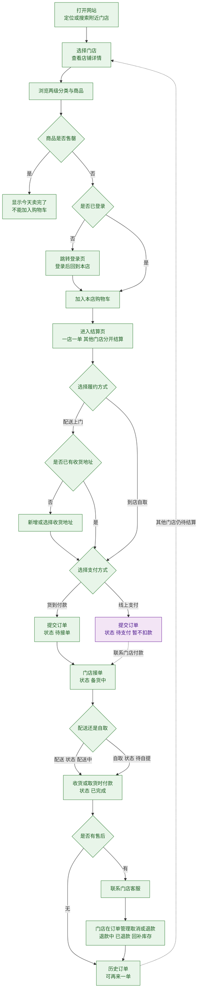
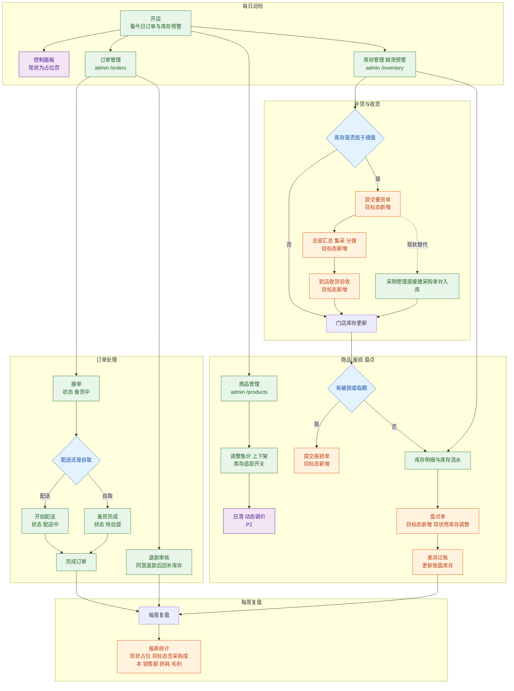
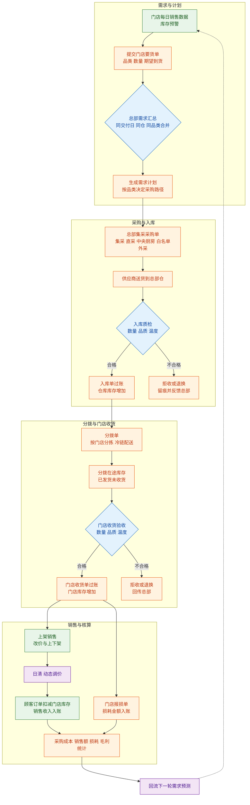

# SDS（捎点啥）多店铺系统 PRD

> **项目名称**: SDS（捎点啥）
> **版本**: v1.3.0（v1.2.0 + 第 11 章「门店供应链与总部集采」目标态）
> **日期**: 2026-11-18
> **场景**: 面向老年人买菜的多店铺电商+进销存系统
> **技术栈**: Monorepo(pnpm+Turborepo) + Hono + Drizzle ORM + Next.js ^16 + React 19.3.0 + React Native 0.83.10 + Expo ~55.0.32 + Ant Design 6.6.6 + Tailwind CSS 3.4 + Zod 4.6.7 + TypeScript 5.7 + Node ≥ 18 + Supabase (PostgreSQL)
> **目录结构**: `apps/`(admin/web/mobile) + `packages/`(api/shared/db/ui/config)

---

## 目录

1. [项目概述](#1-项目概述)
2. [目标用户与场景](#2-目标用户与场景)
3. [功能需求](#3-功能需求)
4. [技术架构](#4-技术架构)
   - 4.1 Monorepo 目录结构
   - 4.2 各包详细结构
   - 4.3 跨包依赖关系
   - 4.4 技术选型
   - 4.5 架构分层
   - 4.6 Drizzle Schema 示例
   - 4.7 Turborepo 任务编排
   - 4.8 环境变量约定
5. [数据表结构](#5-数据表结构)
6. [API 设计](#6-api-设计)
7. [UI/UX 设计规范](#7-uiux-设计规范)
8. [权限模型](#8-权限模型)
9. [里程碑规划](#9-里程碑规划)
10. [风险与对策](#10-风险与对策)
11. [门店供应链与总部集采（目标态）](#11-门店供应链与总部集采目标态)

---

## 1. 项目概述

### 1.1 项目背景

SDS（捎点啥）是一个面向社区老年人的多店铺生鲜电商系统。老年人通过手机查找附近的生鲜店铺，在线下单买菜，支持配送或自取。系统同时提供完整的进销存管理能力（肉、蛋、奶、食用油、面粉等原料采购），帮助店长高效运营。

### 1.2 核心价值

| 维度 | 描述 |
|------|------|
| 顾客侧 | 大字体、极简操作、地图找店、一键下单买菜 |
| 店长侧 | 独立管理界面、进销存一目了然、库存预警 |
| 平台侧 | 多店铺统一管理、数据统计、权限分级 |

### 1.3 典型场景

```
张奶奶（72岁）打开手机 App → 地图自动定位到附近3家生鲜店
→ 选择"阳光店" → 浏览菜品（猪肉、鸡蛋、牛奶、青菜等）
→ 加入购物车 → 确认订单 → 微信支付 → 等待配送
→ 店长收到订单 → 拣货配送 → 订单完成

店长视角：发现鸡蛋库存不足 → 创建采购入库单 → 供应商送货入库 → 库存更新
```

---

## 2. 目标用户与场景

### 2.1 用户角色

| 角色 | 说明 | 使用端 |
|------|------|--------|
| 超级管理员 (super_admin) | 平台运营者，管理所有店铺 | Admin 后台 |
| 店长 (shop_manager) | 单店管理者，独立管理本店 | Admin 后台 + Mobile |
| 店员 (shop_staff) | 协助店长，处理订单/库存 | Mobile |
| 顾客 (customer) | 买菜的老年人 | Web + Mobile |
| 配送员 (delivery) | 配送订单（可由店员兼任） | Mobile |

### 2.2 老年人特殊设计考量

- **大字体**: 全局最小字号 16px，标题 20px+
- **高对比度**: 文字与背景对比度 ≥ 4.5:1
- **简化流程**: 下单步骤 ≤ 3 步（选商品 → 确认 → 支付）
- **语音输入**: 搜索支持语音输入
- **常用地址**: 默认填充上次配送地址
- **客服入口**: 每个页面均有"一键呼叫客服"按钮

---

## 3. 功能需求

### 3.1 多店铺管理

| 功能 | 优先级 | 描述 |
|------|--------|------|
| 店铺创建 | P0 | 超级管理员创建店铺，填写名称、地址、经纬度、营业时间 |
| 地图选址 | P0 | 创建店铺时通过地图选点自动获取经纬度 |
| 附近店铺搜索 | P0 | 顾客端基于 GPS 定位搜索半径内的店铺（默认 3km） |
| 店铺信息管理 | P0 | 编辑店铺名称、封面图、公告、营业状态 |
| 店铺状态切换 | P1 | 营业中/休息中/已关闭 |
| 店铺独立管理 | P0 | 店长只能管理自己负责的店铺，数据隔离 |
| 店铺成员管理 | P0 | 店长添加/移除店员，分配角色 |
| 店铺营业时间 | P1 | 支持按天设置不同营业时间段 |

### 3.2 Admin 管理后台（Ant Design）

| 功能 | 优先级 | 描述 |
|------|--------|------|
| 仪表盘 | P0 | 总营收、今日订单、库存预警、活跃店铺概览 |
| 销售趋势图 | P0 | 本周/本月销售趋势折线图 |
| 店铺管理 | P0 | 店铺列表、创建/编辑/停用店铺 |
| 商品管理 | P0 | 商品 CRUD、分类管理、价格设置、图片上传 |
| 进销存管理 | P0 | 采购入库、库存查询、库存预警、盘点、变动流水 |
| 订单管理 | P0 | 订单列表、详情查看、状态管理、退款处理 |
| 统计分析 | P1 | 按店铺/时间维度统计销售、库存周转 |
| 用户管理 | P0 | 管理员/店长/店员/顾客管理 |
| 权限管理 | P0 | RBAC 角色权限配置 |

### 3.3 Web 顾客端（Next.js）

| 功能 | 优先级 | 描述 |
|------|--------|------|
| 地图找店 | P0 | 基于定位展示附近店铺，点击查看详情 |
| 店铺详情 | P0 | 展示店铺信息 + 分类树（两级） + 商品列表 |
| 商品浏览 | P0 | 按分类浏览商品；进入顶级分类时展示其自身及全部子分类下的商品 |
| 搜索功能 | P0 | 关键词搜索商品，支持语音输入 |
| 购物车 | P0 | 加入/移出购物车，修改数量 |
| 下单支付 | P0 | 确认订单 → 选择配送/自取 → 微信支付 |
| 订单跟踪 | P0 | 查看订单状态（待接单/备货中/配送中/已完成） |
| 订单历史 | P0 | 查看历史订单，支持一键复购 |
| 地址管理 | P0 | 添加/编辑配送地址，设置默认地址 |
| 个人中心 | P1 | 个人信息、收货地址、客服入口 |

#### 3.3.1 顾客下单闭环（当前 Web 实现）

下图把「选店 → 挑菜 → 下单 → 配送或自取 → 收货 → 售后」串成一条可执行路径，重点说明哪些节点会分流（售罄、未登录、多门店、收货地址、支付方式），以及每一步对应哪个订单状态。

> **口径说明**：3.3、3.5 表中的「微信支付」为目标态；当前 Web 实际只开放货到付款，线上支付入口保留但不会发起扣款，提交后订单为「待支付」。一店一单：不同门店不能合并结算，需要分开下单。



图中绿色为现状已有；紫色为入口保留但暂未开通（线上支付）。

### 3.4 Mobile 移动端（React Native）

#### 3.4.1 顾客端

| 功能 | 优先级 | 描述 |
|------|--------|------|
| 地图找店 | P0 | GPS 定位 + 地图展示附近店铺 |
| 商品浏览与下单 | P0 | 与 Web 端功能一致 |
| 订单跟踪 | P0 | 实时订单状态 + 推送通知 |
| 语音搜索 | P1 | 语音输入搜索商品 |
| 一键呼叫 | P0 | 拨打店铺/客服电话 |

#### 3.4.2 店长/店员端

| 功能 | 优先级 | 描述 |
|------|--------|------|
| 工作台 | P0 | 今日营收、订单数、待处理、库存预警数据卡片 |
| 订单处理 | P0 | 接单 → 备货 → 配送/自取 → 完成 |
| 快速进货 | P0 | 创建采购入库单 |
| 库存查看 | P0 | 实时库存列表，预警标红 |
| 经营报表 | P1 | 今日/本周/本月营收统计 |

#### 3.4.3 店长日常经营闭环（系统入口对照）

下图按「每天先看什么 → 处理订单 → 补货收货 → 商品与损耗 → 每周复盘」组织店长的一天与一周，节点直接标注 admin 入口。绿色为当前已可用，橙色为目标态新增（详见第 11 章），紫色为尚未接入的占位能力。当前控制面板与报表统计仍是占位页，日常经营数据以订单管理、库存管理的实际列表为准。



### 3.5 电商功能

| 功能 | 优先级 | 描述 |
|------|--------|------|
| 购物车 | P0 | 按店铺维度独立购物车，跨店不可合并 |
| 订单流程 | P0 | 待支付 → 已支付(待接单) → 备货中 → 配送中/待自取 → 已完成 |
| 取消/退款 | P0 | 支持订单取消和退款流程 |
| 支付集成 | P0 | 微信支付（小程序/JSAPI/H5） |
| 优惠券 | P2 | 满减券、新人券（后期迭代） |
| 评价系统 | P2 | 订单完成后可评价商品和店铺 |

### 3.6 进销存管理

| 功能 | 优先级 | 描述 |
|------|--------|------|
| 采购入库 | P0 | 创建采购单（供应商、原料、数量、单价）→ 入库更新库存 |
| 库存查询 | P0 | 按店铺/分类查看当前库存 |
| 库存预警 | P0 | 库存低于安全阈值时自动预警 |
| 库存盘点 | P1 | 定期盘点，生成盘亏/盘盈记录 |
| 变动流水 | P0 | 所有库存变动记录（入库/出库/销售消耗/盘点调整） |
| 供应商管理 | P1 | 供应商信息、采购历史 |

> **现状与目标态说明**：3.6 描述的是 v1「单店自采」形态；门店供应链确定走「总部集采」后，要货、汇总、总仓、分拨、门店收货、财务口径等目标态统一见 **第 11 章**，本节不重复展开。

**进销存典型原料分类：**

| 分类 | 示例 |
|------|------|
| 肉类 | 猪肉、牛肉、鸡肉、鱼 |
| 蛋类 | 鸡蛋、鸭蛋 |
| 奶制品 | 牛奶、酸奶 |
| 粮油 | 大米、面粉、食用油 |
| 蔬菜 | 白菜、萝卜、西红柿、青菜 |
| 调料 | 盐、酱油、醋 |
| 其他 | 豆制品、水果 |

---

## 4. 技术架构

### 4.1 Monorepo 目录结构

```
sds/
├── apps/
│   ├── admin/              # Ant Design 管理后台
│   ├── web/                # Next.js 顾客 Web 端
│   └── mobile/             # React Native 移动端
├── packages/
│   ├── api/                # Hono API 服务
│   ├── shared/             # 共享类型、常量、工具函数
│   ├── db/                 # Drizzle schema & migrations
│   ├── ui/                 # 共享 UI 组件
│   └── config/             # ESLint / TS / Tailwind 配置
├── pnpm-workspace.yaml
├── turbo.json              # Turborepo 任务编排
└── package.json
```

**目录职责说明：**

| 目录 | 职责 | 说明 |
|------|------|------|
| `apps/admin` | Ant Design 管理后台 | 平台管理员 + 店长的运营后台，含店铺/商品/进销存/订单/统计管理 |
| `apps/web` | Next.js 顾客 Web 端 | 地图找店、商品浏览、下单支付，SSR 友好 |
| `apps/mobile` | React Native 移动端 | 顾客端 + 店长工作台双模式，Expo 管理 |
| `packages/api` | Hono API 服务 | 路由、业务逻辑、中间件、错误处理 |
| `packages/shared` | 共享类型、常量、工具 | TS 类型定义、枚举常量、金额/日期/校验工具 |
| `packages/db` | Drizzle schema & migrations | PostgreSQL 表结构、迁移脚本、RLS 策略、种子数据 |
| `packages/ui` | 共享 UI 组件 | Web 端 Tailwind 组件库 + 设计 Token，与 Antd 主题色对齐 |
| `packages/config` | 配置包 | ESLint flat config、TS base config、Tailwind preset、tsconfig |

**约定：**
- `apps/*` 只做「应用壳 + 业务页面」，不写通用工具逻辑
- `packages/*` 是可复用单元，通过 `@sds/shared`、`@sds/db` 等 workspace 协议引用
- 所有包由 Turborepo 编排 `dev` / `build` / `lint` / `typecheck` 任务，依赖包变更自动触发下游重建

### 4.2 各包详细结构

```
packages/
├── api/                                  # Hono API 服务
│   ├── src/
│   │   ├── index.ts                      # 入口，export default app
│   │   ├── app.ts                        # Hono 实例装配、中间件注册
│   │   ├── routes/
│   │   │   ├── index.ts                  # 路由汇总挂载
│   │   │   ├── auth.ts                   # /api/auth/*
│   │   │   ├── shops.ts                  # /api/shops/*
│   │   │   ├── products.ts               # /api/products/*
│   │   │   ├── orders.ts                 # /api/orders/*
│   │   │   ├── inventory.ts              # /api/inventory/*
│   │   │   ├── purchase.ts               # /api/purchase-orders/*
│   │   │   ├── customers.ts              # /api/customers/*
│   │   │   ├── addresses.ts              # /api/addresses/*
│   │   │   └── stats.ts                  # /api/stats/*
│   │   ├── services/                     # 业务逻辑层
│   │   │   ├── shop.service.ts
│   │   │   ├── product.service.ts
│   │   │   ├── order.service.ts
│   │   │   ├── inventory.service.ts
│   │   │   ├── purchase.service.ts
│   │   │   └── stats.service.ts
│   │   ├── middleware/
│   │   │   ├── auth.ts                   # JWT 解析，注入 ctx.user
│   │   │   ├── rbac.ts                   # 角色/店铺权限校验
│   │   │   ├── shop-scope.ts             # 店铺数据隔离（限定 shopId）
│   │   │   ├── validate.ts               # Zod 请求校验
│   │   │   └── error-handler.ts          # 统一异常捕获
│   │   ├── lib/
│   │   │   ├── response.ts               # 统一响应封装
│   │   │   ├── errors.ts                 # 业务错误码定义
│   │   │   ├── payment.ts                # 微信支付封装
│   │   │   └── map.ts                    # 高德/腾讯地图封装
│   │   └── types/
│   └── package.json
│
├── shared/                               # 共享类型、常量、工具
│   ├── src/
│   │   ├── types/
│   │   │   ├── user.ts                   # UserRole / UserInfo
│   │   │   ├── shop.ts                   # Shop / BusinessHours
│   │   │   ├── product.ts                # Product / Category
│   │   │   ├── order.ts                  # Order / OrderItem / OrderStatus
│   │   │   ├── inventory.ts              # Inventory / StockMovement
│   │   │   ├── purchase.ts               # PurchaseOrder / PurchaseItem
│   │   │   ├── customer.ts               # Customer / Address
│   │   │   └── api.ts                    # ApiResponse / Paginated
│   │   ├── constants/
│   │   │   ├── roles.ts                  # 角色枚举 + 权限映射
│   │   │   ├── order-status.ts           # 订单状态机定义
│   │   │   ├── movement-types.ts         # 库存变动类型
│   │   │   ├── units.ts                  # 计量单位
│   │   │   └── categories.ts             # 生鲜分类预设
│   │   ├── validators/                   # Zod Schema（前后端共用）
│   │   │   ├── shop.schema.ts
│   │   │   ├── order.schema.ts
│   │   │   ├── purchase.schema.ts
│   │   │   └── product.schema.ts
│   │   └── utils/
│   │       ├── money.ts                  # 金额格式化/计算
│   │       ├── date.ts                   # 日期格式化
│   │       ├── distance.ts               # 距离计算（Haversine）
│   │       └── id.ts                     # 订单号/采购单号生成
│   └── package.json
│
├── db/                                   # Drizzle schema & migrations
│   ├── src/
│   │   ├── schema/
│   │   │   ├── users.ts                  # users 表
│   │   │   ├── shops.ts                  # shops + shop_members 表
│   │   │   ├── products.ts               # categories + products 表
│   │   │   ├── inventory.ts              # inventory + stock_movements 表
│   │   │   ├── purchase.ts               # purchase_orders + purchase_items 表
│   │   │   ├── customers.ts              # customers + addresses 表
│   │   │   ├── orders.ts                 # orders + order_items 表
│   │   │   └── index.ts                  # schema 汇总导出
│   │   ├── relations.ts                  # Drizzle relations 定义
│   │   ├── client.ts                     # drizzle 实例（node-postgres）
│   │   ├── rls/
│   │   │   └── policies.sql              # Supabase RLS 策略
│   │   └── seed/
│   │       └── seed.ts                   # 种子数据（店铺、商品、用户）
│   ├── drizzle/                          # 生成的迁移文件
│   ├── drizzle.config.ts
│   └── package.json
│
├── ui/                                   # 共享 UI 组件
│   ├── src/
│   │   ├── tokens/
│   │   │   ├── colors.ts                 # 色板（与 Antd 主题同源）
│   │   │   ├── typography.ts             # 字体/字号规范
│   │   │   └── spacing.ts                # 间距/圆角 Token
│   │   ├── components/
│   │   │   ├── ShopCard.tsx              # 店铺卡片
│   │   │   ├── ProductCard.tsx           # 商品卡片
│   │   │   ├── QuantityStepper.tsx       # 数量步进器（大按钮）
│   │   │   ├── CartBar.tsx               # 购物车浮层
│   │   │   ├── OrderStatusTag.tsx        # 订单状态标签
│   │   │   ├── StockBadge.tsx            # 库存预警徽标
│   │   │   └── PriceText.tsx             # 价格文本
│   │   ├── hooks/                        # useCart / useGeolocation 等
│   │   └── index.ts
│   └── package.json
│
└── config/                               # 配置包
    ├── eslint/
    │   ├── base.js                       # 通用 ESLint 规则
    │   ├── react.js                      # React/TSX 规则
    │   └── node.js                       # Node/服务端规则
    ├── typescript/
    │   ├── base.json                     # tsconfig base
    │   ├── react.json                    # React 项目 tsconfig
    │   └── node.json                     # Node 项目 tsconfig
    └── tailwind/
        ├── preset.js                     # Tailwind preset（SDS 色板/字号）
        └── index.d.ts
```

```
apps/
├── admin/                                # Ant Design 管理后台
│   ├── src/
│   │   ├── main.tsx                      # 入口
│   │   ├── App.tsx                       # 路由配置
│   │   ├── layouts/
│   │   │   ├── BasicLayout.tsx           # 侧边栏 + 顶栏布局
│   │   │   └── BlankLayout.tsx           # 登录页等无布局页
│   │   ├── pages/
│   │   │   ├── dashboard/                # 仪表盘
│   │   │   ├── shops/                    # 店铺管理
│   │   │   ├── products/                 # 商品/分类管理
│   │   │   ├── inventory/                # 进销存（库存/采购/盘点/流水）
│   │   │   ├── orders/                   # 订单管理
│   │   │   ├── stats/                    # 统计分析
│   │   │   ├── users/                    # 用户与权限
│   │   │   └── login/
│   │   ├── components/                   # 业务组件
│   │   ├── stores/                       # Zustand 状态
│   │   ├── services/                     # API 请求封装
│   │   └── theme.ts                      # Antd 主题（引用 @sds/ui tokens）
│   ├── public/
│   └── package.json
│
├── web/                                  # Next.js 顾客 Web 端
│   ├── app/
│   │   ├── layout.tsx                    # 根布局
│   │   ├── page.tsx                      # 首页（地图找店）
│   │   ├── shops/[shopId]/page.tsx       # 店铺详情
│   │   ├── cart/page.tsx                 # 购物车
│   │   ├── checkout/page.tsx             # 确认订单
│   │   ├── orders/page.tsx               # 我的订单
│   │   ├── orders/[orderId]/page.tsx     # 订单详情
│   │   ├── me/page.tsx                   # 个人中心
│   │   └── api/                          # Next.js Route Handler（BFF 代理）
│   ├── components/
│   ├── lib/
│   ├── next.config.js
│   └── package.json
│
└── mobile/                               # React Native 移动端
    ├── src/
    │   ├── App.tsx
    │   ├── navigation/
    │   │   ├── RootNavigator.tsx         # 顾客端/店长端路由切换
    │   │   ├── CustomerTabs.tsx          # 顾客端底部 Tab
    │   │   └── StaffTabs.tsx             # 店长端底部 Tab
    │   ├── screens/
    │   │   ├── customer/                 # 顾客端页面
    │   │   └── staff/                    # 店长端页面
    │   ├── components/
    │   ├── store/                        # Zustand / Jotai
    │   ├── api/                          # 请求封装
    │   └── theme.ts                      # 老年人友好模式主题
    ├── app.json                          # Expo 配置
    └── package.json
```

### 4.3 跨包依赖关系

```
apps/admin ──┐
apps/web   ──┼──> packages/api ──> packages/db ──> Supabase PostgreSQL
apps/mobile ─┘         │
                       ├──> packages/shared（类型/常量/校验）
                       └──> packages/ui（Web 端共享组件）
```

**依赖规则：**
- `packages/db` 只依赖 `packages/shared`（类型），不依赖任何 app
- `packages/api` 可依赖 `db` / `shared`，不可依赖任何 app
- `packages/ui` 只依赖 `shared`（类型 + tokens），保持 UI 无关业务
- `apps/*` 之间**不可互相依赖**，只能通过 `packages/api` 通信

### 4.4 技术选型

| 层级 | 技术 | 版本 | 说明 |
|------|------|------|------|
| Monorepo | pnpm + Turborepo | pnpm 9+ / turbo 2+ | 包管理 + 任务编排 |
| 运行时 | Node.js | ≥ 18 | Hono / Next.js / Drizzle 运行环境 |
| 语言 | TypeScript | ~5.7.0 | 全栈类型共享 |
| API | Hono | 4.x | 轻量高性能 Web 框架 |
| ORM | Drizzle ORM | 0.36+ | schema 定义 + 类型安全查询 + 迁移 |
| 数据库 | Supabase (PostgreSQL) | 15+ | 数据库 + Auth + Storage |
| 认证 | Supabase Auth + JWT | - | 手机号验证码登录 |
| Admin | React + Ant Design | React / React DOM 19.3.0 / Antd ^6.6.6（@ant-design/icons ^6.3.4） | 管理后台 UI |
| Web | Next.js | ^16 (App Router) | SSR/SSG 顾客端 |
| Web 样式 | Tailwind CSS | ^3.4.0 | `packages/ui` 组件基础样式 |
| Mobile | React Native + Expo | RN 0.83.10 / Expo ~55.0.32 | 移动端 |
| 校验 | Zod | ^4.6.7 | 前后端共用 Schema（`packages/shared/validators`） |
| 状态管理 | Zustand | 4.x | 三个 app 统一使用 |
| 地图 | 高德地图 / 腾讯地图 | - | 店铺定位与搜索 |
| 支付 | 微信支付 | V3 API | JSAPI / 小程序支付 |
| 部署 | Vercel (Web/Admin) + Cloudflare Workers (API) | - | 按端独立部署 |

### 4.5 架构分层

```
客户端层 (Admin / Web / Mobile)
    ↓ HTTPS
API 网关层 (Hono: 认证中间件 → RBAC 权限校验 → 店铺隔离 → 路由分发 → 统一响应)
    ↓
业务服务层 (店铺管理 / 电商引擎 / 进销存 / 用户权限 / 地图定位 / 统计报表)
    ↓
数据层 (Supabase PostgreSQL + Drizzle ORM + RLS 行级安全 + Storage 对象存储)
```

**数据库访问链路：**

```
apps/*  →  packages/api (Hono)
              ↓
          packages/db (Drizzle)
              ↓
          Supabase PostgreSQL
              ↓
          RLS 策略二次过滤（shop_members / customers 关联）
```

### 4.6 Drizzle Schema 示例

```typescript
// packages/db/src/schema/shops.ts
import { pgTable, uuid, varchar, text, numeric, timestamp, pgEnum, jsonb, unique } from 'drizzle-orm/pg-core';
import { relations } from 'drizzle-orm';

export const shopStatusEnum = pgEnum('shop_status', ['open', 'closed', 'suspended']);
export const memberRoleEnum = pgEnum('member_role', ['shop_manager', 'shop_staff', 'delivery']);

export const shops = pgTable('shops', {
  id: uuid('id').primaryKey().defaultRandom(),
  name: varchar('name', { length: 100 }).notNull(),
  coverUrl: text('cover_url'),
  address: varchar('address', { length: 200 }).notNull(),
  longitude: numeric('longitude', { precision: 10, scale: 7 }).notNull(),
  latitude: numeric('latitude', { precision: 10, scale: 7 }).notNull(),
  phone: varchar('phone', { length: 11 }),
  businessHours: jsonb('business_hours').$type<BusinessHours>(),
  status: shopStatusEnum('status').default('open').notNull(),
  announcement: text('announcement'),
  createdAt: timestamp('created_at', { withTimezone: true }).defaultNow().notNull(),
  updatedAt: timestamp('updated_at', { withTimezone: true }).defaultNow().notNull(),
});

export const shopMembers = pgTable('shop_members', {
  id: uuid('id').primaryKey().defaultRandom(),
  shopId: uuid('shop_id').notNull().references(() => shops.id),
  userId: uuid('user_id').notNull().references(() => users.id),
  role: memberRoleEnum('role').notNull(),
  createdAt: timestamp('created_at', { withTimezone: true }).defaultNow().notNull(),
}, (t) => ({
  shopUserUnique: unique('shop_members_shop_user_unique').on(t.shopId, t.userId),
}));

// Drizzle relations：声明式描述表间关系，供 db.query 关联查询使用
export const shopsRelations = relations(shops, ({ many }) => ({
  members: many(shopMembers),
  orders: many(orders),
}));

export const shopMembersRelations = relations(shopMembers, ({ one }) => ({
  shop: one(shops, { fields: [shopMembers.shopId], references: [shops.id] }),
  user: one(users, { fields: [shopMembers.userId], references: [users.id] }),
}));
```

```typescript
// packages/db/src/schema/orders.ts
export const orderStatusEnum = pgEnum('order_status', [
  'pending_payment', 'paid', 'preparing', 'delivering',
  'pickup_ready', 'completed', 'cancelled', 'refunded',
]);

export const fulfillmentTypeEnum = pgEnum('fulfillment_type', ['delivery', 'pickup']);
export const paymentMethodEnum = pgEnum('payment_method', ['wechat', 'cash', 'balance']);

export const orders = pgTable('orders', {
  id: uuid('id').primaryKey().defaultRandom(),
  shopId: uuid('shop_id').notNull().references(() => shops.id),
  customerId: uuid('customer_id').notNull().references(() => customers.id),
  orderNo: varchar('order_no', { length: 20 }).notNull().unique(),
  status: orderStatusEnum('status').default('pending_payment').notNull(),
  fulfillmentType: fulfillmentTypeEnum('fulfillment_type').notNull(),
  addressId: uuid('address_id').references(() => addresses.id),
  subtotal: numeric('subtotal', { precision: 10, scale: 2 }).notNull(),
  deliveryFee: numeric('delivery_fee', { precision: 10, scale: 2 }).default('0'),
  discountAmount: numeric('discount_amount', { precision: 10, scale: 2 }).default('0'),
  totalAmount: numeric('total_amount', { precision: 10, scale: 2 }).notNull(),
  paymentMethod: paymentMethodEnum('payment_method'),
  paymentId: varchar('payment_id', { length: 50 }),
  paidAt: timestamp('paid_at', { withTimezone: true }),
  remark: text('remark'),
  createdAt: timestamp('created_at', { withTimezone: true }).defaultNow().notNull(),
  updatedAt: timestamp('updated_at', { withTimezone: true }).defaultNow().notNull(),
});

export const ordersRelations = relations(orders, ({ one, many }) => ({
  shop: one(shops, { fields: [orders.shopId], references: [shops.id] }),
  customer: one(customers, { fields: [orders.customerId], references: [customers.id] }),
  items: many(orderItems),
}));
```

### 4.7 Turborepo 任务编排

```json
{
  "$schema": "https://turbo.build/schema.json",
  "tasks": {
    "dev": {
      "cache": false,
      "persistent": true
    },
    "build": {
      "dependsOn": ["^build"],
      "outputs": ["dist/**", ".next/**", "out/**"]
    },
    "lint": {
      "dependsOn": ["^lint"]
    },
    "typecheck": {
      "dependsOn": ["^typecheck"]
    },
    "db:generate": {
      "cache": false,
      "outputs": ["drizzle/**"]
    },
    "db:migrate": {
      "cache": false,
      "persistent": true
    },
    "db:seed": {
      "cache": false
    }
  }
}
```

**常用命令：**

```bash
pnpm dev              # 并行启动所有 app
pnpm dev --filter web # 只启动 web
pnpm build            # 构建全部（拓扑顺序）
pnpm typecheck        # 全量类型检查
pnpm db:generate      # 生成 Drizzle 迁移
pnpm db:migrate       # 执行迁移
pnpm db:seed          # 写入种子数据
```

### 4.8 环境变量约定

```bash
# 根目录 .env（各包通过 workspace 继承）
DATABASE_URL=postgresql://postgres.xxx@xxx.supabase.co:5432/postgres
SUPABASE_URL=https://xxx.supabase.co
SUPABASE_ANON_KEY=xxx
SUPABASE_SERVICE_ROLE_KEY=xxx

# packages/api
JWT_SECRET=xxx
WECHAT_APP_ID=xxx
WECHAT_MCH_ID=xxx
WECHAT_API_KEY=xxx

# apps/web
NEXT_PUBLIC_API_BASE_URL=http://localhost:8787
# 高德地图（admin / web 共用，浏览器可见）
SDS_PUBLIC_AMAP_KEY=xxx
NEXT_PUBLIC_WECHAT_PAY=xxx

# apps/mobile
EXPO_PUBLIC_API_BASE_URL=http://localhost:8787
EXPO_PUBLIC_MAP_KEY=xxx
```

---

## 5. 数据表结构

> 所有表由 `packages/db/src/schema/` 下的 Drizzle schema 定义，迁移文件由 `drizzle-kit generate` 生成至 `packages/db/drizzle/`。
> 下表中的字段名按数据库蛇形命名（snake_case）列出，Drizzle 中使用驼峰属性映射。

**表清单与 Schema 文件映射：**

| 表名 | Schema 文件 | 说明 |
|------|------------|------|
| `users` | `schema/users.ts` | 用户表 |
| `shops` | `schema/shops.ts` | 店铺表 |
| `shop_members` | `schema/shops.ts` | 店铺成员表 |
| `categories` | `schema/products.ts` | 商品分类表 |
| `products` | `schema/products.ts` | 商品表 |
| `inventory` | `schema/inventory.ts` | 库存表 |
| `stock_movements` | `schema/inventory.ts` | 库存变动流水表 |
| `purchase_orders` | `schema/purchase.ts` | 采购单表 |
| `purchase_items` | `schema/purchase.ts` | 采购明细表 |
| `customers` | `schema/customers.ts` | 顾客表 |
| `addresses` | `schema/customers.ts` | 配送地址表 |
| `orders` | `schema/orders.ts` | 订单表 |
| `order_items` | `schema/orders.ts` | 订单明细表 |

### 5.1 users（用户表）

| 字段 | 类型 | 约束 | 说明 |
|------|------|------|------|
| id | uuid | PK, default gen_random_uuid() | 用户 ID |
| phone | varchar(11) | UNIQUE NOT NULL | 手机号 |
| name | varchar(50) | | 姓名 |
| avatar_url | text | | 头像 URL |
| role | enum | NOT NULL, default 'customer' | super_admin/shop_manager/shop_staff/customer/delivery |
| is_active | boolean | default true | 是否启用 |
| created_at | timestamptz | default now() | 创建时间 |
| updated_at | timestamptz | default now() | 更新时间 |

### 5.2 shops（店铺表）

| 字段 | 类型 | 约束 | 说明 |
|------|------|------|------|
| id | uuid | PK | 店铺 ID |
| name | varchar(100) | NOT NULL | 店铺名称 |
| cover_url | text | | 封面图 URL |
| address | varchar(200) | NOT NULL | 详细地址 |
| longitude | numeric(10,7) | NOT NULL | 经度 |
| latitude | numeric(10,7) | NOT NULL | 纬度 |
| phone | varchar(11) | | 店铺电话 |
| business_hours | jsonb | | 营业时间 {"mon": {"open": "07:00", "close": "20:00"}, ...} |
| status | enum | default 'open' | open/closed/suspended |
| announcement | text | | 店铺公告 |
| created_at | timestamptz | default now() | |
| updated_at | timestamptz | default now() | |

**店铺图片**：`cover_url` 只存图片地址（Supabase Storage `sdsbucket` 的公开 URL），二进制不入库；上传走 `POST /api/admin/uploads`，前端拿到 URL 后再随店铺创建/更新提交。

**营业时间口径**：`business_hours` 按周一到周日存 `{"mon": {"open": "07:00", "close": "20:00"}, ...}`，键固定为 `mon/tue/wed/thu/fri/sat/sun`，时间为 24 小时制 `HH:mm`。统一按「同日时段」存储：`close` 必须晚于 `open`，不支持跨天（如 22:00–02:00 这类跨夜营业不在本期范围，需要时另加 `crossDay` 标记）；对象中未出现的日期视为当天休息，整体为空表示未设置。

### 5.3 shop_members（店铺成员表）

| 字段 | 类型 | 约束 | 说明 |
|------|------|------|------|
| id | uuid | PK | |
| shop_id | uuid | FK → shops.id, NOT NULL | 店铺 ID |
| user_id | uuid | FK → users.id, NOT NULL | 用户 ID |
| role | enum | NOT NULL | shop_manager / shop_staff / delivery |
| created_at | timestamptz | default now() | |

**唯一约束**: (shop_id, user_id)

### 5.4 categories（商品分类表）

| 字段 | 类型 | 约束 | 说明 |
|------|------|------|------|
| id | uuid | PK | |
| shop_id | uuid | FK → shops.id, NOT NULL | 所属店铺 |
| parent_id | uuid | FK → categories(id), 可空 | 父分类；为空表示顶级分类 |
| level | smallint | NOT NULL, default 1 | 层级：1 顶级 / 2 子级 |
| name | varchar(50) | NOT NULL | 分类名称（蔬菜/肉类/蛋奶/粮油/调料） |
| sort_order | int | default 0 | 排序（同级内生效） |
| icon_url | text | | 分类图标 |
| is_active | boolean | default true | 是否启用 |
| created_at | timestamptz | default now() | |

**唯一约束**：`(shop_id, parent_id, name)` —— 同一父级下分类名唯一，不同父级允许重名。

**分类树规则**：

- 分类固定两级：顶级分类可包含子分类，子分类不可再包含子分类（`level` 仅取 1 或 2）。
- 分类可同时挂商品与子分类；商品可归属任意一级分类，也可不选分类。
- 父分类必须与子分类同属一个店铺，不支持跨店铺移动。
- 删除分类时：存在子分类则拒绝删除并提示先删除或移动子分类；存在商品则拒绝删除并提示先移出商品；两者都不存在才允许删除。
- 停用分类只影响前台展示，不改变其下商品的上下架状态。

### 5.5 products（商品表）

| 字段 | 类型 | 约束 | 说明 |
|------|------|------|------|
| id | uuid | PK | |
| shop_id | uuid | FK → shops.id, NOT NULL | 所属店铺 |
| category_id | uuid | FK → categories.id | 分类 ID（可归属任意一级分类，可空） |
| name | varchar(100) | NOT NULL | 商品名称 |
| description | text | | 商品描述 |
| image_url | text | | 商品图片 |
| price | numeric(10,2) | NOT NULL | 售价 |
| unit | varchar(20) | NOT NULL | 单位（斤/个/袋/瓶/箱） |
| stock_type | enum | default 'tracked' | tracked(关联库存) / untracked(不追踪) |
| is_available | boolean | default true | 是否上架 |
| sort_order | int | default 0 | 排序 |
| created_at | timestamptz | default now() | |
| updated_at | timestamptz | default now() | |

**分类口径**：商品可归属任意一级分类。按分类筛选与统计商品时，统一按「该分类自身 + 其全部子分类」计算；需要只统计该分类本身时使用精确匹配（商品列表接口传 `include_descendants=false`）。

### 5.6 inventory（库存表）

| 字段 | 类型 | 约束 | 说明 |
|------|------|------|------|
| id | uuid | PK | |
| shop_id | uuid | FK → shops.id, NOT NULL | 店铺 ID |
| product_id | uuid | FK → products.id, NOT NULL | 商品 ID |
| raw_material_name | varchar(100) | | 原料名称（大豆、食用油等，可独立于商品） |
| quantity | numeric(10,2) | NOT NULL, default 0 | 当前库存数量 |
| unit | varchar(20) | NOT NULL | 单位（kg/L/个/袋） |
| min_threshold | numeric(10,2) | default 0 | 安全库存阈值 |
| max_threshold | numeric(10,2) | | 最大库存上限 |
| updated_at | timestamptz | default now() | 最后变动时间 |

**唯一约束**: (shop_id, product_id) 或 (shop_id, raw_material_name)

**分类库存口径**: 按分类查询库存时，默认包含所选分类下的全部子分类商品（与商品列表口径一致）。

### 5.7 stock_movements（库存变动流水表）

| 字段 | 类型 | 约束 | 说明 |
|------|------|------|------|
| id | uuid | PK | |
| shop_id | uuid | FK → shops.id, NOT NULL | 店铺 ID |
| inventory_id | uuid | FK → inventory.id, NOT NULL | 库存项 ID |
| movement_type | enum | NOT NULL | purchase_in(采购入库) / sale_out(销售出库) / adjustment(盘点调整) / waste(损耗) |
| quantity_change | numeric(10,2) | NOT NULL | 变动数量（正=入库，负=出库） |
| balance_after | numeric(10,2) | NOT NULL | 变动后余额 |
| reference_id | uuid | | 关联单据 ID（采购单 ID / 订单 ID） |
| reference_type | enum | | purchase_order / order / stocktake |
| operator_id | uuid | FK → users.id | 操作人 |
| remark | text | | 备注 |
| created_at | timestamptz | default now() | |

### 5.8 purchase_orders（采购单表）

| 字段 | 类型 | 约束 | 说明 |
|------|------|------|------|
| id | uuid | PK | |
| shop_id | uuid | FK → shops.id, NOT NULL | 店铺 ID |
| order_no | varchar(20) | UNIQUE NOT NULL | 采购单号（PO + 日期 + 序号） |
| supplier_name | varchar(100) | | 供应商名称 |
| supplier_phone | varchar(11) | | 供应商电话 |
| total_amount | numeric(10,2) | NOT NULL, default 0 | 采购总金额 |
| status | enum | default 'pending' | pending(待入库) / received(已入库) / cancelled(已取消) |
| operator_id | uuid | FK → users.id | 操作人（店长/店员） |
| remark | text | | 备注 |
| created_at | timestamptz | default now() | |
| received_at | timestamptz | | 入库时间 |

### 5.9 purchase_items（采购明细表）

| 字段 | 类型 | 约束 | 说明 |
|------|------|------|------|
| id | uuid | PK | |
| purchase_order_id | uuid | FK → purchase_orders.id, NOT NULL | 采购单 ID |
| inventory_id | uuid | FK → inventory.id | 关联库存项 |
| item_name | varchar(100) | NOT NULL | 品名（猪肉/鸡蛋/牛奶/食用油/面粉等） |
| quantity | numeric(10,2) | NOT NULL | 数量 |
| unit | varchar(20) | NOT NULL | 单位 |
| unit_price | numeric(10,2) | NOT NULL | 单价 |
| subtotal | numeric(10,2) | NOT NULL | 小计 = quantity × unit_price |

### 5.10 customers（顾客表）

| 字段 | 类型 | 约束 | 说明 |
|------|------|------|------|
| id | uuid | PK | |
| user_id | uuid | FK → users.id, UNIQUE | 关联用户 |
| nickname | varchar(50) | | 昵称 |
| real_name | varchar(50) | | 真实姓名 |
| phone | varchar(11) | | 联系电话 |
| default_address_id | uuid | FK → addresses.id | 默认配送地址 |
| total_orders | int | default 0 | 历史订单数 |
| total_spent | numeric(10,2) | default 0 | 累计消费 |
| created_at | timestamptz | default now() | |

### 5.11 addresses（配送地址表）

| 字段 | 类型 | 约束 | 说明 |
|------|------|------|------|
| id | uuid | PK | |
| customer_id | uuid | FK → customers.id, NOT NULL | 顾客 ID |
| contact_name | varchar(50) | NOT NULL | 联系人 |
| contact_phone | varchar(11) | NOT NULL | 联系电话 |
| province | varchar(20) | | 省 |
| city | varchar(20) | | 市 |
| district | varchar(20) | | 区 |
| detail | varchar(200) | NOT NULL | 详细地址 |
| longitude | numeric(10,7) | | 经度 |
| latitude | numeric(10,7) | | 纬度 |
| is_default | boolean | default false | 是否默认 |
| remark | text | | 配送备注（如"老人独居，请送到家门口"） |
| created_at | timestamptz | default now() | |

### 5.12 orders（订单表）

| 字段 | 类型 | 约束 | 说明 |
|------|------|------|------|
| id | uuid | PK | |
| shop_id | uuid | FK → shops.id, NOT NULL | 店铺 ID |
| customer_id | uuid | FK → customers.id, NOT NULL | 顾客 ID |
| order_no | varchar(20) | UNIQUE NOT NULL | 订单号 |
| status | enum | NOT NULL, default 'pending_payment' | pending_payment / paid / preparing / delivering / pickup_ready / completed / cancelled / refunded |
| fulfillment_type | enum | NOT NULL | delivery(配送) / pickup(自取) |
| address_id | uuid | FK → addresses.id | 配送地址（delivery 时必填） |
| subtotal | numeric(10,2) | NOT NULL | 商品总额 |
| delivery_fee | numeric(10,2) | default 0 | 配送费 |
| discount_amount | numeric(10,2) | default 0 | 优惠金额 |
| total_amount | numeric(10,2) | NOT NULL | 实付金额 |
| payment_method | enum | | wechat / cash / balance |
| payment_id | varchar(50) | | 第三方支付流水号 |
| paid_at | timestamptz | | 支付时间 |
| remark | text | | 订单备注 |
| created_at | timestamptz | default now() | |
| updated_at | timestamptz | default now() | |

### 5.13 order_items（订单明细表）

| 字段 | 类型 | 约束 | 说明 |
|------|------|------|------|
| id | uuid | PK | |
| order_id | uuid | FK → orders.id, NOT NULL | 订单 ID |
| product_id | uuid | FK → products.id | 商品 ID |
| product_name | varchar(100) | NOT NULL | 商品名称（冗余） |
| product_image | text | | 商品图片（冗余） |
| unit_price | numeric(10,2) | NOT NULL | 下单时单价 |
| quantity | numeric(10,2) | NOT NULL | 数量 |
| unit | varchar(20) | NOT NULL | 单位 |
| subtotal | numeric(10,2) | NOT NULL | 小计 |

### 5.14 RLS 行级安全策略

```sql
-- shops: 店长只能管理自己的店铺
CREATE POLICY "shop_managers_manage_own_shops" ON shops
  FOR ALL USING (
    EXISTS (
      SELECT 1 FROM shop_members
      WHERE shop_members.shop_id = shops.id
      AND shop_members.user_id = auth.uid()
      AND shop_members.role IN ('shop_manager')
    )
    OR (SELECT role FROM users WHERE id = auth.uid()) = 'super_admin'
  );

-- orders: 顾客只能看自己的订单，店长只能看本店订单
CREATE POLICY "customers_view_own_orders" ON orders
  FOR SELECT USING (
    customer_id IN (SELECT id FROM customers WHERE user_id = auth.uid())
    OR shop_id IN (
      SELECT shop_id FROM shop_members WHERE user_id = auth.uid()
    )
  );

-- inventory: 店长/店员只能管理本店库存
CREATE POLICY "shop_staff_manage_inventory" ON inventory
  FOR ALL USING (
    shop_id IN (
      SELECT shop_id FROM shop_members WHERE user_id = auth.uid()
    )
  );
```

**RLS 策略文件位置**: `packages/db/src/rls/policies.sql`

> Drizzle 不直接管理 RLS 策略（属 PostgreSQL 原生能力），因此策略以独立 `.sql` 文件维护，
> 由 `packages/db` 的迁移脚本或独立的 `pnpm db:rls` 命令推送到 Supabase。
> Supabase 控制台新建的表默认关闭 RLS，需显式执行 `ALTER TABLE ... ENABLE ROW LEVEL SECURITY`。

### 5.15 事务与并发控制

关键写操作（采购入库、订单支付扣库存）必须使用 Drizzle 事务，保证一致性：

```typescript
// packages/api/src/services/purchase.service.ts
import { db } from '@sds/db';
import { inventory, stockMovements } from '@sds/db/schema';
import { eq, sql } from 'drizzle-orm';

export async function receivePurchaseOrder(
  purchaseOrderId: string,
  operatorId: string,
) {
  return db.transaction(async (tx) => {
    const items = await tx.query.purchaseItems.findMany({
      where: (t, { eq }) => eq(t.purchaseOrderId, purchaseOrderId),
    });

    for (const item of items) {
      if (!item.inventoryId) continue;

      // 悲观锁：SELECT ... FOR UPDATE 防止并发超卖
      const [current] = await tx
        .select()
        .from(inventory)
        .where(eq(inventory.id, item.inventoryId))
        .for('update');

      const balanceAfter = Number(current.quantity) + Number(item.quantity);

      await tx
        .update(inventory)
        .set({ quantity: sql`${inventory.quantity} + ${item.quantity}`, updatedAt: new Date() })
        .where(eq(inventory.id, item.inventoryId));

      await tx.insert(stockMovements).values({
        shopId: current.shopId,
        inventoryId: item.inventoryId,
        movementType: 'purchase_in',
        quantityChange: item.quantity,
        balanceAfter,
        referenceId: purchaseOrderId,
        referenceType: 'purchase_order',
        operatorId,
      });
    }

    await tx
      .update(purchaseOrders)
      .set({ status: 'received', receivedAt: new Date() })
      .where(eq(purchaseOrders.id, purchaseOrderId));
  });
}
```

---

## 6. API 设计

### 6.1 统一响应格式

```json
{
  "code": 0,
  "message": "success",
  "data": { },
  "timestamp": 1731510000000
}
```

错误响应：

```json
{
  "code": 40001,
  "message": "参数错误: shop_id is required",
  "data": null,
  "timestamp": 1731510000000
}
```

**实现示例（`packages/api/src/routes/shops.ts`）：**

```typescript
import { Hono } from 'hono';
import { zValidator } from '@hono/zod-validator';
import { db } from '@sds/db';
import { shops } from '@sds/db/schema';
import { eq, and, sql } from 'drizzle-orm';
import { nearbyShopsSchema } from '@sds/shared/validators';
import { ok } from '../lib/response';

export const shopsRoute = new Hono()
  .get('/nearby', zValidator('query', nearbyShopsSchema), async (c) => {
    const { lat, lng, radius = 3000, page = 1, size = 20 } = c.req.valid('query');

    // Haversine 距离计算（PostgreSQL 侧完成，避免拉全量数据）
    const rows = await db
      .select({
        id: shops.id,
        name: shops.name,
        coverUrl: shops.coverUrl,
        address: shops.address,
        phone: shops.phone,
        businessHours: shops.businessHours,
        status: shops.status,
        distance: sql<number>`ROUND(
          6371000 * 2 * ASIN(SQRT(
            POWER(SIN(RADIANS(${shops.latitude} - ${lat}) / 2), 2) +
            COS(RADIANS(${lat})) * COS(RADIANS(${shops.latitude})) *
            POWER(SIN(RADIANS(${shops.longitude} - ${lng}) / 2), 2)
          ))
        )`,
      })
      .from(shops)
      .where(and(eq(shops.status, 'open')))
      .orderBy(sql`distance ASC`)
      .limit(size)
      .offset((page - 1) * size);

    const filtered = rows.filter((r) => r.distance <= radius);

    return c.json(ok({ total: filtered.length, items: filtered }));
  });
```

### 6.2 认证模块

| 方法 | 路径 | 说明 | 权限 |
|------|------|------|------|
| POST | `/api/auth/send-code` | 发送短信验证码 | 公开 |
| POST | `/api/auth/login` | 手机号验证码登录 | 公开 |
| POST | `/api/auth/refresh` | 刷新 token | 已登录 |
| GET | `/api/auth/me` | 获取当前用户信息 | 已登录 |

**登录请求示例：**

```json
POST /api/auth/login
{
  "phone": "13800138000",
  "code": "1234"
}
```

```json
{
  "code": 0,
  "data": {
    "access_token": "eyJ...",
    "refresh_token": "eyJ...",
    "user": {
      "id": "uuid",
      "phone": "13800138000",
      "name": "张奶奶",
      "role": "customer"
    }
  }
}
```

### 6.3 店铺模块

| 方法 | 路径 | 说明 | 权限 |
|------|------|------|------|
| GET | `/api/shops/nearby` | 搜索附近店铺 | 公开 |
| GET | `/api/shops/:id` | 获取店铺详情 | 公开 |
| POST | `/api/shops` | 创建店铺 | super_admin |
| PUT | `/api/shops/:id` | 更新店铺信息 | super_admin / shop_manager |
| PATCH | `/api/shops/:id/status` | 切换店铺状态 | super_admin / shop_manager |
| GET | `/api/shops/:id/members` | 获取店铺成员 | shop_manager |
| POST | `/api/shops/:id/members` | 添加店铺成员 | shop_manager |
| DELETE | `/api/shops/:id/members/:userId` | 移除店铺成员 | shop_manager |
| POST | `/api/admin/uploads` | 上传图片（multipart，字段 `file`，可选 `dir`；返回公开 URL） | shops.write |

**店铺字段**：创建/更新支持 `coverUrl`（合法 URL 或 null）与 `businessHours`（见 5.2 营业时间口径，非法时段返回 400 `INVALID_BODY`）。列表返回二者用于回显与缩略展示。上传接口在存储未配置时返回 503 `STORAGE_NOT_CONFIGURED`，类型/体积校验失败分别返回 415 / 413。

**附近店铺搜索：**

```
GET /api/shops/nearby?lat=39.9042&lng=116.4074&radius=3000&page=1&size=20
```

```json
{
  "code": 0,
  "data": {
    "total": 3,
    "items": [
      {
        "id": "uuid",
        "name": "阳光生鲜店",
        "cover_url": "https://...",
        "address": "朝阳区xx路xx号",
        "distance": 850,
        "status": "open",
        "business_hours": {"open": "07:00", "close": "20:00"}
      }
    ]
  }
}
```

### 6.4 商品模块

| 方法 | 路径 | 说明 | 权限 |
|------|------|------|------|
| GET | `/api/shops/:shopId/categories` | 获取分类列表（扁平返回，含 parent_id / level） | 公开 |
| POST | `/api/shops/:shopId/categories` | 创建分类（支持 parent_id，层级由服务端校验） | shop_manager |
| PUT | `/api/categories/:id` | 更新分类（含改父级移动） | shop_manager |
| PATCH | `/api/categories/reorder` | 同级整体排序（`{shop_id, parent_id, ids}`） | shop_manager |
| PATCH | `/api/categories/:id/products` | 把该分类直属商品批量迁移到目标分类 | shop_manager |
| DELETE | `/api/categories/:id` | 删除分类（有子分类或有商品时拒绝） | shop_manager |
| GET | `/api/shops/:shopId/products` | 获取商品列表 | 公开 |
| GET | `/api/products/:id` | 获取商品详情 | 公开 |
| POST | `/api/shops/:shopId/products` | 创建商品 | shop_manager |
| PUT | `/api/products/:id` | 更新商品 | shop_manager |
| PATCH | `/api/products/:id/availability` | 上架/下架 | shop_manager |
| DELETE | `/api/products/:id` | 删除商品 | shop_manager |

**商品列表请求示例：**

```
GET /api/shops/shop-uuid/products?category_id=cat-uuid&page=1&size=20&keyword=猪肉
```

分类筛选默认包含子分类商品；传 `include_descendants=false` 时仅匹配该分类本身。

### 6.5 订单模块

| 方法 | 路径 | 说明 | 权限 |
|------|------|------|------|
| POST | `/api/orders` | 创建订单 | customer |
| GET | `/api/orders/:id` | 获取订单详情 | customer / shop_staff |
| GET | `/api/orders/my` | 获取我的订单 | customer |
| GET | `/api/shops/:shopId/orders` | 获取店铺订单 | shop_manager / shop_staff |
| PATCH | `/api/orders/:id/status` | 更新订单状态 | shop_staff |
| POST | `/api/orders/:id/cancel` | 取消订单 | customer / shop_manager |
| POST | `/api/orders/:id/refund` | 申请退款 | customer |
| POST | `/api/orders/:id/repurchase` | 一键复购 | customer |

**创建订单请求示例：**

```json
POST /api/orders
{
  "shop_id": "shop-uuid",
  "fulfillment_type": "delivery",
  "address_id": "addr-uuid",
  "items": [
    {"product_id": "prod-uuid-1", "quantity": 2, "unit": "斤"},
    {"product_id": "prod-uuid-2", "quantity": 1, "unit": "袋"}
  ],
  "remark": "麻烦送到家门口，老人腿脚不便"
}
```

**响应示例：**

```json
{
  "code": 0,
  "data": {
    "order_id": "order-uuid",
    "order_no": "OD20261113001",
    "status": "pending_payment",
    "total_amount": 68.50,
    "payment_params": {
      "jsapi_params": { }
    }
  }
}
```

### 6.6 进销存模块

| 方法 | 路径 | 说明 | 权限 |
|------|------|------|------|
| GET | `/api/shops/:shopId/inventory` | 获取库存列表 | shop_manager / shop_staff |
| GET | `/api/shops/:shopId/inventory/alerts` | 获取库存预警列表 | shop_manager |
| PUT | `/api/inventory/:id` | 更新库存阈值 | shop_manager |
| GET | `/api/shops/:shopId/stock-movements` | 获取库存变动流水 | shop_manager |
| POST | `/api/shops/:shopId/purchase-orders` | 创建采购入库单 | shop_manager |
| POST | `/api/purchase-orders/:id/receive` | 确认入库 | shop_manager / shop_staff |
| GET | `/api/shops/:shopId/purchase-orders` | 获取采购单列表 | shop_manager |
| GET | `/api/purchase-orders/:id` | 获取采购单详情 | shop_manager |
| POST | `/api/shops/:shopId/stocktake` | 创建盘点单 | shop_manager |

**创建采购单请求示例：**

```json
POST /api/shops/shop-uuid/purchase-orders
{
  "supplier_name": "朝阳区粮油批发",
  "supplier_phone": "13900139000",
  "items": [
    {"inventory_id": "inv-uuid-1", "item_name": "猪肉", "quantity": 50, "unit": "kg", "unit_price": 28.0},
    {"inventory_id": "inv-uuid-2", "item_name": "鸡蛋", "quantity": 30, "unit": "kg", "unit_price": 12.0},
    {"inventory_id": "inv-uuid-3", "item_name": "牛奶", "quantity": 20, "unit": "箱", "unit_price": 45.0},
    {"inventory_id": "inv-uuid-4", "item_name": "食用油", "quantity": 10, "unit": "桶", "unit_price": 65.0},
    {"inventory_id": "inv-uuid-5", "item_name": "面粉", "quantity": 25, "unit": "kg", "unit_price": 5.5}
  ],
  "remark": "本周常规补货"
}
```

**入库确认后自动执行：**

1. 更新 `inventory.quantity` += `quantity`
2. 写入 `stock_movements` 记录（movement_type = 'purchase_in'）
3. 更新 `purchase_orders.status` = 'received'

### 6.7 统计模块

| 方法 | 路径 | 说明 | 权限 |
|------|------|------|------|
| GET | `/api/shops/:shopId/stats/dashboard` | 店铺仪表盘 | shop_manager |
| GET | `/api/shops/:shopId/stats/sales` | 销售统计 | shop_manager |
| GET | `/api/shops/:shopId/stats/inventory` | 库存统计 | shop_manager |
| GET | `/api/admin/stats/overview` | 平台总览 | super_admin |

**仪表盘响应示例：**

```json
{
  "code": 0,
  "data": {
    "today": {
      "revenue": 1280.50,
      "order_count": 48,
      "pending_orders": 3,
      "low_stock_count": 5
    },
    "sales_trend": [
      {"date": "2026-11-07", "revenue": 980.0},
      {"date": "2026-11-08", "revenue": 1120.0},
      {"date": "2026-11-09", "revenue": 860.0},
      {"date": "2026-11-10", "revenue": 1340.0},
      {"date": "2026-11-11", "revenue": 990.0},
      {"date": "2026-11-12", "revenue": 1150.0},
      {"date": "2026-11-13", "revenue": 1280.5}
    ]
  }
}
```

---

## 7. UI/UX 设计规范

### 7.1 设计原则

- **简约清爽**: 大量留白，扁平化设计，无渐变
- **亲民易懂**: 大字体、高对比度、图标+文字双标注
- **浅色调为主**: 以淡蓝色为基调，温暖友好的视觉感受
- **老年人友好**: 最小字号 16px，按钮高度 ≥ 48px，关键操作有明确反馈

### 7.2 色板

| 色彩 | 色值 | 用途 |
|------|------|------|
| 主色 Primary | `#378ADD` | 按钮、链接、选中状态、品牌色 |
| 主色浅 | `#B5D4F4` | 标签背景、轻量强调 |
| 主色极浅 | `#E6F1FB` | 页面背景、卡片背景 |
| 辅助绿 Success | `#1D9E75` | 正常状态、已完成 |
| 辅助绿浅 | `#E1F5EE` | 成功状态背景 |
| 辅助黄 Warning | `#EF9F27` | 待处理、库存预警 |
| 辅助黄浅 | `#FAEEDA` | 预警状态背景 |
| 辅助红 Danger | `#E24B4A` | 错误、取消、缺货 |
| 辅助红浅 | `#FCEBEB` | 错误状态背景 |
| 文字主色 | `#042C53` | 标题、主要文字 |
| 文字次要 | `#5F5E5A` | 描述、次要文字 |
| 文字提示 | `#888780` | 占位符、辅助提示 |
| 背景色 | `#F8FBFE` | 页面底色 |
| 卡片白 | `#FFFFFF` | 卡片背景 |
| 边框 | `#E0E8F0` | 分割线、边框 |

### 7.3 字体规范

| 层级 | 字号 | 字重 | 行高 | 用途 |
|------|------|------|------|------|
| H1 | 24px | 500 | 1.3 | 页面大标题 |
| H2 | 20px | 500 | 1.4 | 模块标题（移动端最小标题） |
| H3 | 18px | 500 | 1.4 | 卡片标题 |
| Body-L | 18px | 400 | 1.6 | 正文（移动端老年模式） |
| Body | 16px | 400 | 1.6 | 正文（移动端标准 / Admin） |
| Body-S | 14px | 400 | 1.5 | 正文（Admin 表格、Web） |
| Caption | 13px | 400 | 1.4 | 辅助说明、时间戳 |

### 7.4 间距与圆角

| Token | 值 | 用途 |
|-------|-----|------|
| radius-sm | 6px | 小按钮、标签 |
| radius-md | 8px | 输入框、小卡片 |
| radius-lg | 12px | 卡片、弹窗（首选） |
| radius-xl | 16px | 大容器、底部弹层 |
| spacing-xs | 4px | 紧凑间距 |
| spacing-sm | 8px | 元素内间距 |
| spacing-md | 12px | 卡片内间距 |
| spacing-lg | 16px | 模块间距 |
| spacing-xl | 24px | 区块间距 |
| spacing-2xl | 32px | 页面级间距 |

### 7.5 设计 Token 单一数据源

色板、字号、间距以 `packages/ui/src/tokens/` 为唯一来源，Admin 的 Antd 主题、Web 端的 Tailwind preset、Mobile 端的主题常量全部由此派生，避免三端视觉漂移。

```typescript
// packages/ui/src/tokens/colors.ts
export const sdsColors = {
  primary: '#378ADD',
  primaryLight: '#B5D4F4',
  primaryLighter: '#E6F1FB',
  success: '#1D9E75',
  successLight: '#E1F5EE',
  warning: '#EF9F27',
  warningLight: '#FAEEDA',
  danger: '#E24B4A',
  dangerLight: '#FCEBEB',
  textPrimary: '#042C53',
  textSecondary: '#5F5E5A',
  textTertiary: '#888780',
  background: '#F8FBFE',
  card: '#FFFFFF',
  border: '#E0E8F0',
} as const;

export type SdsColorKey = keyof typeof sdsColors;
```

### 7.6 Ant Design 主题配置（apps/admin）

```typescript
import { ConfigProvider } from 'antd';
import { sdsColors } from '@sds/ui';

export const sdsTheme = {
  token: {
    colorPrimary: sdsColors.primary,
    colorSuccess: sdsColors.success,
    colorWarning: sdsColors.warning,
    colorError: sdsColors.danger,
    colorTextBase: sdsColors.textPrimary,
    colorBgLayout: sdsColors.background,
    colorBgContainer: sdsColors.card,
    borderRadius: 8,
    borderRadiusLG: 12,
    fontFamily: "'PingFang SC', 'Microsoft YaHei', sans-serif",
    fontSize: 14,
    controlHeight: 36,
  },
  components: {
    Button: {
      borderRadius: 8,
      controlHeight: 40,
      fontWeight: 500,
    },
    Card: {
      borderRadiusLG: 12,
      boxShadowTertiary: 'none',
    },
    Table: {
      headerBg: sdsColors.primaryLighter,
      headerColor: sdsColors.textPrimary,
      rowHoverBg: sdsColors.background,
    },
    Menu: {
      itemSelectedBg: sdsColors.primaryLighter,
      itemSelectedColor: sdsColors.primary,
    },
  },
};
```

### 7.7 Tailwind Preset（packages/config/tailwind/preset.js）

```javascript
// packages/config/tailwind/preset.js
const { sdsColors } = require('@sds/ui');

module.exports = {
  content: [
    './src/**/*.{ts,tsx}',
    '../../packages/ui/src/**/*.{ts,tsx}',
  ],
  theme: {
    extend: {
      colors: {
        primary: {
          DEFAULT: sdsColors.primary,
          light: sdsColors.primaryLight,
          lighter: sdsColors.primaryLighter,
        },
        success: { DEFAULT: sdsColors.success, light: sdsColors.successLight },
        warning: { DEFAULT: sdsColors.warning, light: sdsColors.warningLight },
        danger:  { DEFAULT: sdsColors.danger,  light: sdsColors.dangerLight },
        text: {
          primary: sdsColors.textPrimary,
          secondary: sdsColors.textSecondary,
          tertiary: sdsColors.textTertiary,
        },
        surface: { DEFAULT: sdsColors.background, card: sdsColors.card },
      },
      borderRadius: {
        sm: '6px', md: '8px', lg: '12px', xl: '16px',
      },
      spacing: {
        xs: '4px', sm: '8px', md: '12px', lg: '16px', xl: '24px', '2xl': '32px',
      },
      fontSize: {
        'body-lg': ['18px', { lineHeight: '1.6' }],
        body: ['16px', { lineHeight: '1.6' }],
        'body-sm': ['14px', { lineHeight: '1.5' }],
        caption: ['13px', { lineHeight: '1.4' }],
      },
    },
  },
  plugins: [],
};
```

**使用示例：**

```tsx
// apps/web/components/ProductCard.tsx
import { PriceText, StockBadge } from '@sds/ui';

export function ProductCard({ product }: { product: Product }) {
  return (
    <div className="rounded-lg border border-[#E0E8F0] bg-card p-4">
      <div className="flex items-start justify-between">
        <h3 className="text-body-lg font-medium text-text-primary">{product.name}</h3>
        <PriceText value={product.price} unit={product.unit} />
      </div>
      <StockBadge quantity={product.stockQuantity} threshold={product.minThreshold} />
    </div>
  );
}
```

### 7.8 共享 UI 组件清单（packages/ui）

| 组件 | 说明 | 使用端 |
|------|------|--------|
| `ShopCard` | 店铺卡片（封面、名称、距离、营业状态） | Web / Mobile |
| `ProductCard` | 商品卡片（图片、名称、描述、价格、加购） | Web / Mobile |
| `QuantityStepper` | 数量步进器（±按钮 ≥ 44px） | Web / Mobile |
| `CartBar` | 购物车底部浮层 | Web / Mobile |
| `OrderStatusTag` | 订单状态标签（按状态映射色板） | Web / Mobile / Admin |
| `StockBadge` | 库存预警徽标（正常绿/预警黄/缺货红） | Web / Mobile / Admin |
| `PriceText` | 价格文本（¥符号 + 两位小数） | Web / Mobile / Admin |
| `StatusTimeline` | 订单进度时间轴 | Web / Mobile |
| `EmptyState` | 空状态占位 | Web / Mobile / Admin |

> RN 端因不支持 DOM，`packages/ui` 的 Web 组件通过 `react-native-web` 别名或独立 `*.native.tsx` 分文件实现，同名导出保证三端 API 一致。

### 7.9 移动端特殊规范（老年人友好）

```typescript
export const mobileTheme = {
  colors: {
    primary: '#378ADD',
    primaryLight: '#E6F1FB',
    textPrimary: '#042C53',
    textSecondary: '#5F5E5A',
    background: '#F8FBFE',
    card: '#FFFFFF',
    danger: '#E24B4A',
    success: '#1D9E75',
    warning: '#EF9F27',
  },
  fontSizes: {
    title: 22,       // 大标题
    heading: 20,     // 标题
    bodyLarge: 18,   // 正文（老年模式默认）
    body: 16,        // 正文（标准模式）
    caption: 14,     // 辅助文字
  },
  spacing: {
    cardPadding: 16,
    screenPadding: 16,
    itemGap: 12,
  },
  button: {
    minHeight: 52,   // 大按钮，方便点击
    borderRadius: 12,
    fontSize: 18,
  },
  input: {
    minHeight: 52,
    borderRadius: 12,
    fontSize: 18,
  },
};
```

---

## 8. 权限模型

### 8.1 RBAC 角色权限矩阵

| 功能模块 | super_admin | shop_manager | shop_staff | delivery | customer |
|----------|:-----------:|:------------:|:----------:|:--------:|:--------:|
| 平台仪表盘 | ✓ | - | - | - | - |
| 创建/删除店铺 | ✓ | - | - | - | - |
| 编辑店铺信息 | ✓ | ✓(本店) | - | - | - |
| 店铺成员管理 | ✓ | ✓(本店) | - | - | - |
| 商品管理 | ✓ | ✓(本店) | ✓(本店) | - | - |
| 分类管理（含子分类、排序、移动） | ✓ | ✓(本店) | ✓(本店) | - | - |
| 采购入库 | ✓ | ✓(本店) | ✓(本店) | - | - |
| 库存管理 | ✓ | ✓(本店) | ✓(本店) | - | - |
| 订单查看 | ✓ | ✓(本店) | ✓(本店) | ✓(分配) | ✓(自己) |
| 订单状态更新 | ✓ | ✓(本店) | ✓(本店) | ✓(分配) | - |
| 订单取消/退款 | ✓ | ✓(本店) | - | - | ✓(自己) |
| 统计报表 | ✓ | ✓(本店) | - | - | - |
| 浏览商品 | ✓ | ✓ | ✓ | ✓ | ✓ |
| 下单购买 | - | - | - | - | ✓ |
| 地址管理 | - | - | - | - | ✓ |

### 8.2 数据隔离策略

- **店铺级隔离**: shop_manager / shop_staff 只能访问 `shop_members` 中关联的店铺数据
- **顾客级隔离**: customer 只能查看和操作自己的订单、地址
- **实现方式**: Supabase RLS（Row Level Security）行级安全策略 + API 层权限校验双重保障

---

## 9. 里程碑规划

### Phase 1: 基础搭建（第 1-2 周）

- [ ] Monorepo 初始化：`pnpm-workspace.yaml` + `turbo.json` + `packages/config`（ESLint/TS/Tailwind）
- [ ] Supabase 项目创建，`packages/db` 接入 Drizzle（drizzle.config.ts + client.ts）
- [ ] `packages/shared` 骨架：类型、常量、枚举、Zod validators
- [ ] `packages/db` schema 落地：13 张表 Drizzle 定义 + 首次迁移
- [ ] `packages/api` Hono 骨架：app.ts、路由汇总、中间件、统一响应
- [ ] 用户认证（手机号验证码登录）+ RBAC 权限中间件
- [ ] `packages/ui` 设计 Token 定义（colors/typography/spacing）

### Phase 2: 店铺与商品（第 3-4 周）

- [ ] `apps/admin` 搭建（Antd + React Router + BasicLayout + 主题接入）
- [ ] 店铺管理 CRUD + 地图选点（高德/腾讯地图 SDK 集成）
- [ ] 店铺成员管理
- [ ] 商品分类管理（两级树：新建子分类、同级排序、改父级移动、删除保护）
- [ ] 商品 CRUD + 图片上传（Supabase Storage）
- [ ] `packages/api` services 层落地（shop / product）

### Phase 3: 电商核心（第 5-6 周）

- [ ] `apps/web` 搭建（Next.js App Router + Tailwind preset 接入）
- [ ] 地图找店页面（GPS 定位 + 附近店铺列表）
- [ ] 店铺详情 + 商品列表页
- [ ] `packages/ui` 核心组件（ShopCard / ProductCard / QuantityStepper / CartBar）
- [ ] 购物车功能（按店铺维度）
- [ ] 下单流程 + 微信支付集成
- [ ] 订单列表 + 详情 + 状态跟踪

### Phase 4: 进销存管理（第 7-8 周）

- [ ] 库存管理页面（`packages/api` inventory.service）
- [ ] 采购入库流程（purchase.service + 事务化入库）
- [ ] 库存预警机制（阈值检查 + 定时任务）
- [ ] 库存变动流水（stock_movements 全链路记录）
- [ ] 库存盘点功能

> 注：Phase 4 为 v1 单店进销存规划；总部集采模式的落地拆解见 11.9。

### Phase 5: 移动端（第 9-10 周）

- [ ] `apps/mobile` 搭建（Expo + 顾客端/店长端双路由）
- [ ] 顾客端页面（地图找店、商品浏览、下单、订单跟踪）
- [ ] 店长/店员工作台
- [ ] 移动端订单处理流程
- [ ] 移动端库存查看
- [ ] 老年人友好模式（大字体、语音搜索、一键呼叫）

### Phase 6: 完善与上线（第 11-12 周）

- [ ] 统计报表模块（`packages/api` stats.service + Admin 图表）
- [ ] 推送通知（订单状态变更）
- [ ] 性能优化（API 缓存、图片 CDN、列表虚拟化）
- [ ] 全量测试与 Bug 修复
- [ ] 部署上线（Web/Admin → Vercel, API → Cloudflare Workers）
- [ ] 移动端发布（iOS App Store / Android 应用市场）

---

## 10. 风险与对策

| 风险 | 影响 | 对策 |
|------|------|------|
| 老年人不会使用 App | 用户流失 | 极简 UI + 大字体 + 语音输入 + 子女代付功能（P2） |
| 库存数据不准 | 进销存混乱 | 销售自动扣库存 + 定期盘点 + 变动全流水可追溯 |
| 地图定位偏差 | 找不到店铺 | 支持手动选择地址 + 多地图服务商兜底 |
| 微信支付失败 | 订单异常 | 支付状态轮询 + 超时自动关单 + 退款自动处理 |
| 多店铺数据泄露 | 安全事故 | Supabase RLS + API 权限双重校验 + 敏感操作审计日志 |
| 高并发下单 | 库存超卖 | 库存扣减使用 `SELECT ... FOR UPDATE` + Drizzle 事务 |
| 移动端性能 | 体验差 | RN FlashList 优化长列表 + 图片懒加载 + Skeleton 占位 |
| Monorepo 依赖膨胀 | 构建变慢 | Turborepo 任务缓存 + `dependsOn: ["^build"]` 拓扑编排 + `packages/ui` 按需导出 |
| Drizzle 与 Supabase RLS 冲突 | 权限失效 | 直连时通过 `SET LOCAL request.jwt.claims` 注入用户身份，让 RLS 生效 |
| 三端设计漂移 | 视觉不一致 | 设计 Token 单一来源（`packages/ui/src/tokens`）+ Antd/Tailwind/RN 主题统一派生 |

---

## 11. 门店供应链与总部集采（目标态）

> **阅读方式**：本章是 v1.3.0 新增的**目标态**设计，不推翻第 3～9 章的历史内容。  
> 第 5、6 章的 `inventory / purchase_orders` 等表结构与接口描述，代表 v1「单店自采」模型；当前代码已演进为「总部商品库 + 门店 SKU + 门店库存」结构，二者差异见 11.7。  
> 本章所有**新增表、新增字段、状态机与权限点均为「建议」**，标注「现状」的才是仓库里已经存在的能力。  
> 供应商主体与供货门店关系，与 [docs/proposals/supplier-archive.md](../proposals/supplier-archive.md) 保持一致：**供应商平台级 + `shop_suppliers` 供货关系**。

### 11.1 目标流程与术语

目标流程（对应用户提供的业务流程图）：

```
门店每日销售数据 / 库存预警
  → 门店提交要货需求（品类、数量、时效）
  → 总部汇总需求（叠加历史销量、天气、促销因子）
  → 品类分层决策
      ├─ 核心生鲜：总部集采 / 产地直采 / 供应商招标
      ├─ 短保加工鲜食：中央厨房统一生产配送
      └─ 极少数应急本地鲜蔬：总部白名单内的区域采购
  → 供应商送货至总部冷链仓 / 区域分仓
  → 仓内质检、分拣、称重、贴标（品控卡点）
  → 按门店订单分拨、冷链配送到店
  → 门店收货验收（数量、品质、温度）
      ├─ 合格 → 上架销售（日清 / 动态调价）
      └─ 不合格 → 拒收 / 退换货，系统留痕并反馈总部
  → 销售数据回流总部，进入下一轮需求预测
```

**供应链最小闭环（P0 单据流转）**：

下图对应 11.9 的 P0 范围，把「要货 → 集采 → 分拨 → 收货 → 门店库存 → 销售与损耗统计」串成一条带回流线的闭环，并标出三个关键卡点（需求汇总、入库质检、门店验收）。它解决的是「每张单据在哪个环节生效、库存从哪一刻开始归属谁」的问题。绿色为现状已有，橙色为目标态新增，蓝色为关键卡点，紫色为 P2 能力。



| 术语 | 定义 |
|------|------|
| 要货单 | 门店按日/按周期提交的订货需求，含品类、数量、期望到货时间 |
| 需求汇总 | 总部按交付日 + 仓 + 品类合并各门店要货，形成采购/生产决策输入 |
| 采购路径 | `centralized`（总部集采）、`direct`（产地直采/招标）、`central_kitchen`（中央厨房）、`regional_whitelist`（白名单区域采购） |
| 入库单 | 供应商送货到仓后的收货质检与入库凭证，只有「已过账」才增加仓库库存 |
| 分拨单 | 仓 → 门店（或门店 → 门店）的调拨指令与在途凭证 |
| 门店收货单 | 门店对分拨到货的数量/品质/温度验收结果 |
| 报损单 | 仓或门店对不可销售商品的数量与成本核销 |
| 盘点单 | 对账面库存与实际库存的差异确认与调整 |
| 在途库存 | 已发货但尚未被下游收货确认的库存，按单据实时推导，不单独维护余额 |
| 移动加权平均成本 | 同一 SKU 在同一库存地点，每次入库后按「(原库存金额 + 本次入库金额) ÷ 新数量」重算 |

**现状基线（2026-11）**：

- 总部维护 `catalog_categories / catalog_products / catalog_skus`，门店侧落成 `products / product_skus`；
- 门店库存为 `product_sku_stocks`（SKU × 门店），数量变化写 `stock_movements`；
- 采购单 `purchase_orders` 以门店为主体，供应商为门店附属（本次按 11.7 升级为平台级）；
- 顾客下单扣门店库存，取消/退款回补；未实现总部仓、分拨、要货单、报损单、盘点单。

### 11.2 角色与职责边界

| 环节 | 总部商品运营 | 总部采购 | 总仓 / 区域仓 | 总部财务 | 门店店长 | 门店店员 |
|------|:---:|:---:|:---:|:---:|:---:|:---:|
| 商品/品类/定价策略 | 负责 | 参与 | - | 查看 | 查看 | - |
| 供应商档案与供货关系 | 参与 | 负责 | - | 查看 | 查看本店 | - |
| 要货需求上报 | - | - | - | - | 负责 | 可代填（店长确认） |
| 需求汇总与品类决策 | 负责品类 | 负责 | 提供产能/库容 | - | 查看 | - |
| 采购下单 | 参与 | 负责 | - | 查看 | - | - |
| 入库质检与称重贴标 | - | 参与 | 负责 | - | - | - |
| 分拨出库 | - | - | 负责 | - | 查看 | - |
| 门店收货验收 | - | - | 客服支持 | - | 负责 | 可代收（店长授权） |
| 拒收/退换发起 | 审核 | 审核 | 执行 | 查看 | 发起 | - |
| 门店报损 | 审核规则 | - | - | 查看 | 负责 | 发起（店长确认） |
| 仓内报损 | - | - | 发起 | 审核 | - | - |
| 盘点 | - | - | 仓盘点 | 查看 | 门店盘点 | 执行 |
| 采购价 / 售价 | 售价策略 | 采购价 | - | 查看 | 店内调价（授权范围内） | - |
| 财务统计 | 品类视角 | 供应商视角 | 仓储视角 | 全量 | 本店视角 | - |

权限落地建议：

- 沿用现有 RBAC（`admin_roles / admin_permissions`），新增权限点按「动作 + 资源」拆分：`requisitions.read/write/review`、`demand.read/write`、`purchasing.read/write`、`inbound.read/write/post`、`distribution.read/write/dispatch`、`shop_receipt.read/write`、`returns.read/write/approve`、`loss.read/write/approve`、`stocktake.read/write/approve`、`finance.report.read`、`warehouse.read/write`；
- 供应商权限按 `suppliers.read/write` 设计，与 `docs/proposals/supplier-archive.md` 一致；
- 金额相关动作（采购价修改、报损过账、盘点过账、退款审批）单独授权，不能由「能开单」隐含；
- 门店角色只能看本店单据；总部角色按组织范围；仓角色按仓库范围（建议用 `admin_user_warehouses` 或权限条件表达）。

### 11.3 单据体系与状态机

**统一约定（建议）**：

- 每张单据都有 `xxx_no`（业务单号）、`status`、`created_by_admin_id`、`approved_by_admin_id`、`posted_at`、`remark`、`created_at / updated_at`；
- 状态只能按白名单流转，API 层校验；每次流转写 `document_events`（建议表：`document_type / document_id / from_status / to_status / operator_admin_id / reason / created_at`）；
- 「过账（posted）」是库存/财务唯一生效点；过账后修改必须走红冲单，不允许直接改数量；
- 单据行保存 `sku_id`、`quantity`、`unit_cost`、`retail_price_snapshot` 等快照，后续改价不影响历史。

#### 11.3.1 门店要货单 `shop_requisitions` / `shop_requisition_items`（建议）

| 字段 | 类型 | 约束 | 说明 |
|------|------|------|------|
| `id` | uuid | PK | |
| `requisition_no` | varchar(24) | UNIQUE | `RQ + 门店 + 日期 + 序号` |
| `shop_id` | uuid | FK → shops | 要货门店 |
| `request_date` | date | NOT NULL | 提交日 |
| `expected_date` | date | NOT NULL | 期望到货日 |
| `time_window` | varchar(16) | | `morning / afternoon / all_day` |
| `priority` | varchar(8) | | `normal / urgent` |
| `status` | varchar(16) | | 见状态机 |
| `submitted_by` / `reviewed_by` | uuid | FK → admin_users | 提交人 / 审核人 |
| `reviewed_at` | timestamptz | | |
| `remark` | text | | |

明细：`product_sku_id`、`catalog_sku_id`、`requested_qty`、`suggested_qty`（系统建议量）、`approved_qty`、`unit`、`source`（`manual / alert / forecast`）。

状态机：

```
draft → submitted → reviewing → approved / partially_approved / rejected
approved → merged（进入汇总计划）→ fulfilled（已分拨/已收货）→ closed
draft / submitted → cancelled（门店撤回）
approved → cancelled（总部取消，需填原因）
```

关键规则：门店只能改 `draft`；`submitted` 后只能撤回；`approved_qty` 只能由总部调整；已被汇总计划引用的行不可单独取消。

#### 11.3.2 需求汇总与品类决策 `demand_plans` / `demand_plan_items`（建议）

| 字段 | 类型 | 约束 | 说明 |
|------|------|------|------|
| `id` | uuid | PK | |
| `plan_no` | varchar(24) | UNIQUE | `DP + 交付日 + 序号` |
| `delivery_date` | date | NOT NULL | 目标到货日 |
| `warehouse_id` | uuid | FK → warehouses | 供货仓 |
| `status` | varchar(16) | | 见状态机 |
| `version` | int | default 1 | 决策版本 |
| `decided_by` | uuid | FK → admin_users | 品类决策人 |
| `decided_at` | timestamptz | | |
| `factors` | jsonb | | 历史销量、天气、促销等**因子快照**，便于复盘 |
| `remark` | text | | |

明细：`catalog_sku_id`、`total_requested_qty`、`forecast_qty`、`final_qty`、`purchase_path`、`supplier_id`（直采/白名单时）、`source_requisition_item_ids`（jsonb）、`decision_note`。

状态机：

```
collecting → deciding → decided → locked（已生成采购/生产单）→ closed
collecting / deciding → cancelled
decided → deciding（重开决策，版本 +1）
```

#### 11.3.3 采购单 `purchase_orders`（扩展现有表）

现状：以 `shop_id` 为主体、供应商必须属于该门店（见 2.x 代码）。目标态：总部采购单以**仓库**为主体，`shop_id` 可空（兼容历史门店自采单）。

新增/调整字段（建议）：

| 字段 | 类型 | 约束 | 说明 |
|------|------|------|------|
| `warehouse_id` | uuid | FK → warehouses，条件必填 | 总部/区域仓采购单必填 |
| `purchase_path` | varchar(24) | | `centralized / direct / central_kitchen / regional_whitelist` |
| `demand_plan_id` | uuid | FK → demand_plans | 来源汇总计划 |
| `buyer_admin_id` | uuid | FK → admin_users | 采购员 |
| `expected_arrival_date` | date | | 预计到货 |
| `freight_amount` | numeric(12,2) | default 0 | 运费（按行/重量分摊） |
| `tax_amount` | numeric(12,2) | default 0 | 税额（口径见开放问题） |
| `settlement_method_snapshot` | varchar(24) | | 下单时供应商结算方式快照 |
| `status` | varchar(20) | | 由 `draft/submitted/received/cancelled` 扩展 |

明细新增：`catalog_sku_id`、`ordered_qty`、`accepted_qty`、`rejected_qty`、`freight_allocated`、`loss_qty`、`unit_cost`（替代含义需明确：采购单价）。

状态机：

```
draft → submitted → approved → confirmed（已下单）→ in_transit
in_transit → partially_received → received → closed
draft / submitted / approved / confirmed → cancelled（需原因；已入库只能红冲）
received → closed（对账完成）
```

#### 11.3.4 入库单 / 收货质检单 `inbound_receipts` / `inbound_receipt_items`（建议）

| 字段 | 类型 | 约束 | 说明 |
|------|------|------|------|
| `id` | uuid | PK | |
| `receipt_no` | varchar(24) | UNIQUE | `IR + 仓 + 日期 + 序号` |
| `warehouse_id` | uuid | FK → warehouses | 收货仓 |
| `purchase_order_id` | uuid | FK → purchase_orders | 采购入库时必填 |
| `source_type` | varchar(16) | | `purchase / production / transfer_in` |
| `supplier_id` | uuid | FK → suppliers | 采购入库时必填 |
| `received_at` | timestamptz | | |
| `inspector_admin_id` | uuid | FK → admin_users | 质检人 |
| `temperature_ok` | boolean | | 冷链温度是否合格 |
| `temperature_celsius` | numeric(5,1) | | 实测温度（可选多点） |
| `vehicle_no` | varchar(32) | | 车牌 |
| `status` | varchar(16) | | 见状态机 |
| `total_received_qty` / `accepted_qty` / `rejected_qty` / `loss_qty` | numeric(12,2) | default 0 | 汇总 |
| `freight_allocated` | numeric(12,2) | | 本单分摊运费 |
| `posted_at` / `posted_by` | timestamptz / uuid | | 过账信息 |

明细：`po_item_id`、`sku_id`、`received_qty`、`accepted_qty`、`rejected_qty`、`loss_qty`（分拣/称重损耗）、`unit_cost`、`allocated_freight`、`reject_reason_code`、`batch_no`、`expiry_date`（可选）。

状态机：

```
draft → inspecting → accepted / partially_accepted / rejected → posted
posted → reversed（红冲，需审批，生成反向流水）
draft / inspecting → cancelled
```

关键规则：**只有 `posted` 才增加仓库库存**；`rejected_qty` 不进入库存，生成退换/索赔单；`loss_qty` 进入仓内损耗（成本口径见 11.6）。

#### 11.3.5 分拨单 `distribution_orders` / `distribution_order_items`（建议）

| 字段 | 类型 | 约束 | 说明 |
|------|------|------|------|
| `id` | uuid | PK | |
| `distribution_no` | varchar(24) | UNIQUE | `DO + 日期 + 序号` |
| `type` | varchar(24) | | `warehouse_to_shop / shop_to_shop / return_to_warehouse` |
| `from_warehouse_id` | uuid | 条件必填 | 仓 → 店 / 仓 → 店退货 |
| `from_shop_id` | uuid | 条件必填 | 店 → 店 |
| `to_shop_id` | uuid | 条件必填 | 目的门店 |
| `status` | varchar(16) | | 见状态机 |
| `planned_date` | date | | 计划配送日 |
| `dispatched_at` / `received_at` | timestamptz | | 出库 / 收货时间 |
| `carrier` / `vehicle_no` | varchar | | 承运信息 |
| `temperature_zone` | varchar(8) | | `chilled / frozen / ambient` |
| `remark` | text | | |

明细：`sku_id`、`allocated_qty`、`shipped_qty`、`received_qty`、`rejected_qty`、`short_qty`、`unit_cost`、`retail_price_snapshot`。

状态机：

```
draft → allocated → picking → shipped（出库过账）→ in_transit
in_transit → received / partially_received → closed
draft / allocated → cancelled
```

过账点：`shipped` 扣减来源仓/店库存并形成分拨在途；`received` 由门店收货单确认后增加门店库存。

#### 11.3.6 门店收货单 `shop_receipts` / `shop_receipt_items`（建议）

| 字段 | 类型 | 约束 | 说明 |
|------|------|------|------|
| `id` | uuid | PK | |
| `receipt_no` | varchar(24) | UNIQUE | `SR + 门店 + 日期 + 序号` |
| `distribution_id` | uuid | FK → distribution_orders | 来源分拨单 |
| `shop_id` | uuid | FK → shops | 收货门店 |
| `received_by` | uuid | FK → admin_users | 收货人 |
| `status` | varchar(16) | | `draft / received / discrepancy / closed` |
| `temperature_ok` | boolean | | 到店温度 |
| `signature_url` / `photo_urls` | text / jsonb | | 签字与现场照片（可选） |

明细：`distribution_item_id`、`sku_id`、`received_qty`、`accepted_qty`、`rejected_qty`、`short_qty`、`reject_reason_code`、`temperature_ok`、`shelf_life_ok`。

状态机：

```
draft → received（全部合格）→ closed
draft → discrepancy（存在拒收/短装/温度异常）→ closed（差异处理完成）
```

关键规则：只有 `accepted_qty` 增加门店库存；`rejected_qty` 生成拒收/退换单；差异未处理完不能自动 `closed`。

#### 11.3.7 拒收 / 退换单 `return_orders` / `return_order_items`（建议）

| 字段 | 类型 | 约束 | 说明 |
|------|------|------|------|
| `id` | uuid | PK | |
| `return_no` | varchar(24) | UNIQUE | `RT + 日期 + 序号` |
| `type` | varchar(24) | | `shop_reject / return_to_supplier / shop_to_shop_return` |
| `scope` | varchar(8) | | `warehouse / shop` |
| `from_shop_id` / `from_warehouse_id` | uuid | 条件必填 | 退货来源 |
| `to_supplier_id` | uuid | FK → suppliers | 退供应商时必填 |
| `reference_type` / `reference_id` | varchar / uuid | | 来源入库单 / 分拨单 / 门店收货单 |
| `reason_code` | varchar(24) | | `quality / temperature / short / over / damaged / near_expiry / wrong_item` |
| `status` | varchar(16) | | 见状态机 |
| `total_qty` / `total_cost` | numeric(12,2) | | |
| `settlement_amount` | numeric(12,2) | | 与供应商的冲减金额（无应付模块时仅记录） |

状态机：

```
draft → submitted → approved → shipped → received → settled → closed
draft / submitted → cancelled
```

过账点：`shipped` 扣减来源库存（按移动加权平均成本）；`received` 由接收方确认；退供应商不增加任何库存，`settled` 记录采购成本冲减。

#### 11.3.8 报损单 `loss_orders` / `loss_order_items`（建议）

| 字段 | 类型 | 约束 | 说明 |
|------|------|------|------|
| `id` | uuid | PK | |
| `loss_no` | varchar(24) | UNIQUE | `LS + 日期 + 序号` |
| `scope` | varchar(8) | | `warehouse / shop` |
| `warehouse_id` / `shop_id` | uuid | 条件必填 | 报损地点 |
| `loss_date` | date | NOT NULL | 业务日期（财务口径） |
| `reason_code` | varchar(24) | | `spoilage / breakage / expired / process / normal_shrink / other` |
| `status` | varchar(16) | | `draft / submitted / approved / posted / cancelled` |
| `total_qty` / `total_cost` | numeric(12,2) | | 成本按过账时点移动加权平均 |

明细：`sku_id`、`qty`、`unit_cost`、`batch_no`、`reason_note`。

状态机：

```
draft → submitted → approved → posted
draft / submitted → cancelled
posted → reversed（红冲）
```

关键规则：`posted` 扣库存并写 `waste`（仓）或 `waste`（店）流水；门店报损需店长确认，超过阈值需总部审核（阈值待定）。

#### 11.3.9 盘点单 `stocktakes` / `stocktake_items`（建议）

| 字段 | 类型 | 约束 | 说明 |
|------|------|------|------|
| `id` | uuid | PK | |
| `stocktake_no` | varchar(24) | UNIQUE | `ST + 日期 + 序号` |
| `scope` | varchar(8) | | `warehouse / shop` |
| `warehouse_id` / `shop_id` | uuid | 条件必填 | 盘点地点 |
| `count_date` | date | | 盘点日 |
| `status` | varchar(16) | | `draft / counting / submitted / approved / posted / cancelled` |
| `diff_qty` / `diff_cost` | numeric(12,2) | | 汇总差异 |
| `counted_by` / `approved_by` | uuid | FK → admin_users | |

明细：`sku_id`、`book_qty`、`counted_qty`、`diff_qty`、`unit_cost`、`diff_cost`、`note`。

状态机：

```
draft → counting → submitted → approved → posted
draft / counting → cancelled
posted → reversed（红冲，需审批）
```

关键规则：`posted` 按差异写 `adjustment` 流水（盘盈/盘亏），成本按盘点时点移动加权平均；差异超阈值升级总部审批。

### 11.4 库存层级与记账规则

#### 11.4.1 三层库存

| 层级 | 承载对象 | 余额表（建议） | 说明 |
|------|----------|----------------|------|
| 总部仓 / 区域分仓 | SKU × 仓库 | `warehouse_stocks(warehouse_id, sku_id, quantity, reserved_qty, avg_unit_cost)` | 仓库可售库存；含冷链温区属性 |
| 在途 | 采购在途 + 分拨在途 | **不建余额表**，按单据实时推导 | 采购在途 = 采购单已确认/在途数量 − 已入库合格数量；分拨在途 = 分拨已发数量 − 门店已收数量 |
| 门店 | SKU × 门店（现状） | `product_sku_stocks`（建议补 `avg_unit_cost`、`reserved_qty`） | 顾客下单直接扣减 |

> 实现注记（迁移 0023）：`warehouse_stocks.sku_id` 指向总部规格 `catalog_skus`；仓库持有总部规格，分拨到门店时再映射为门店 `product_skus`。

**仓库主数据（建议）**：`warehouses(id, code, name, type hq/regional, address, cold_zone_supported, status)` + `admin_user_warehouses(admin_user_id, warehouse_id)`。

#### 11.4.2 所有权与记账时点

| 事件 | 库存归属变化 | 账务动作 |
|------|--------------|----------|
| 采购单确认发货 | 供应商 → 采购在途（默认风险自离场转移，待拍板） | 不写库存余额；在途报表可见 |
| 入库单 `posted` | 采购在途 → 仓库在库 | `warehouse_stocks.quantity += accepted_qty`；写 `purchase_in` 流水；在途自动减少 |
| 分拨单 `shipped` | 仓库在库 → 分拨在途（仍归总部） | 扣仓库库存；写 `transfer_out`；在途增加 |
| 门店收货 `accepted` | 分拨在途 → 门店在库 | `product_sku_stocks.quantity += accepted_qty`；写 `transfer_in`；在途减少 |
| 门店拒收 | 分拨在途 → 退回仓/供应商 | 不加门店库存；生成退换单；后续按退换单过账 |
| 销售出库 | 门店在库 → 已售 | 扣门店库存；写 `sale_out` |
| 报损 / 盘点 | 所在层级核减/调整 | 写 `waste` / `adjustment` |

**避免重复计数**：

1. 同一批货在任一时刻只存在于一个层级：`采购在途 → 仓库在库 → 分拨在途 → 门店在库`，每步只在一个单据过账点写一次；
2. 在途是由单据推导的视图/汇总，不写独立余额表，避免「在途余额 + 单据」双重口径；
3. `stock_movements` 增加地点维度（建议 `location_type + location_id`，或 `warehouse_id` 与 `shop_id` 二选一），并调整唯一键为 `(location, sku, movement_type, reference_type, reference_id)`；
4. 调拨按**成本价**记账，不产生销售收入；门店间调拨同理；
5. 任何库存扣减前校验可用量（`quantity - reserved_qty`），禁止负库存；红冲必须生成反向流水而非改历史。

### 11.5 品类分层与采购策略

| 路径 | 典型品类 | 决策方 | 供货/生产方 | 入库来源 | 建议字段 |
|------|----------|--------|-------------|----------|----------|
| 总部集采 / 产地直采 / 招标 | 肉、菜、水果等核心生鲜 | 总部采购 + 品类 | 平台级供应商 | 采购单 → 入库单 | `purchase_path=centralized/direct`、`demand_plan_id`、`supplier_id` |
| 中央厨房配送 | 短保加工鲜食 | 总部商品 + 中央厨房 | 中央厨房（内部） | 生产批次 → 入库单 | `source_type=production`、`production_batch_id`、`purchase_path=central_kitchen` |
| 白名单区域采购 | 极少数应急本地鲜蔬 | 总部维护白名单，门店/区域申请 | 区域供应商 | 采购单 → 入库单 | `purchase_path=regional_whitelist`、`whitelist_id`、`exception_reason` |

落到同一套单据上的区分方式（建议）：

- `purchase_orders.purchase_path` 决定审批流与可选供应商范围；
- `inbound_receipts.source_type` 区分「采购入库 / 生产入库 / 调拨入库」；
- 中央厨房不建虚假供应商，使用 `production_batches`（建议）记录生产批次、配方、产出 SKU 与成本；
- 白名单采购必须有 `whitelist_supplier` 关系与例外原因，超过金额/频次阈值升级总部审批；
- 三类路径最终都进入 `warehouse_stocks` 与同一套库存流水，只是 `reference_type` 不同，报表可按 `purchase_path` 拆分。

### 11.6 财务口径

> 以下只给计算方式与取数来源，不预设任何具体金额。

| 指标 | 计算方式 | 取数来源（目标态） |
|------|----------|--------------------|
| 采购金额 | Σ(`采购单价 × 下单数量`) + 运费 + 税额（口径待定） | `purchase_orders` / `purchase_order_items` |
| 采购成本（入库口径） | Σ(`合格入库数量 × 采购单价`) + 分摊运费 + 分摊税额 − 退货冲减 | `inbound_receipts` / `inbound_receipt_items`、`return_orders` |
| 入库单位成本 | 本次入库总成本 ÷ `accepted_qty`（含运费分摊；拒收与验收扣重不计入库存） | 入库单过账时写入 |
| 移动加权平均成本 | `new_avg = (old_qty × old_avg + accepted_qty × inbound_unit_cost) ÷ (old_qty + accepted_qty)` | `warehouse_stocks.avg_unit_cost` / `product_sku_stocks.avg_unit_cost` |
| 销售金额 | Σ(`order_items.unit_price × quantity`) − 商品级优惠分摊；**不含配送费**；退款按 `refund_amount` 冲减 | `orders` / `order_items` / `order_payments` |
| 销售成本（COGS） | Σ(`售出数量 × 售出时点移动加权平均成本`) | 销售出库流水 `unit_cost` / 成本层 |
| 损耗数量 | Σ 报损单过账数量 + 验收扣重 + 分拣损耗 | `loss_orders`、`inbound_receipts.loss_qty`、`stock_movements(waste)` |
| 损耗金额 | Σ(`损耗数量 × 过账时点移动加权平均成本`) | `loss_orders.total_cost`、流水 `unit_cost` |
| 毛利 | 销售金额 − 销售成本 | 上述两项 |
| 毛利率 | 毛利 ÷ 销售金额 | |
| 损耗率（成本口径，建议采购/仓储主用） | 损耗金额 ÷ (销售成本 + 损耗金额) | |
| 损耗率（销售口径，建议门店主用） | 损耗金额 ÷ 销售金额 | |

补充口径：

- **采购价与售价的关系**：采购价进入库存成本，售价只影响销售收入；两者差额不是毛利，必须经过销售成本结转后才形成毛利；
- **调价**：售价变更只影响变更后的订单；建议新增 `price_change_logs(sku_id, shop_id, old_price, new_price, reason, effective_at, operator)` 留痕；
- **日清**：日清折扣视为售价下调，直接减少销售收入与毛利，不改变库存成本；未售出部分按报损落账；
- **退货给供应商**：冲减采购成本与库存，不冲减销售收入；若已售出后召回，需同时走退款与损耗/退货流程（待开放问题确认）；
- **维度**：门店、仓库、品类（含两级分类路径）、SKU、供应商、采购路径、日期（业务日期而非创建时间）、单据类型；所有报表按「过账时间 + 业务日期」双口径可查；
- **税费**：当前系统无税务模块，建议先记录含税/不含税标记与税额字段，报表口径待财务确认。

### 11.7 与现有实现的映射与差距

#### 11.7.1 可直接复用（现状）

| 能力 | 现状位置 | 复用方式 |
|------|----------|----------|
| 总部商品/分类/SKU | `catalog_categories / catalog_products / catalog_skus`（[schema/catalog.ts](file:///Users/whoitao/cyber/github/sds/packages/db/src/schema/catalog.ts)、[schema/skus.ts](file:///Users/whoitao/cyber/github/sds/packages/db/src/schema/skus.ts)） | 作为要货、汇总、采购、分拨的统一 SKU 主数据 |
| 门店商品/SKU | `products / product_skus` | 门店收货后直接落现有 SKU，不新建商品模型 |
| 门店库存/流水 | `product_sku_stocks`、`stock_movements`（[schema/skus.ts L116-L139](file:///Users/whoitao/cyber/github/sds/packages/db/src/schema/skus.ts#L116-L139)、[schema/inventory.ts](file:///Users/whoitao/cyber/github/sds/packages/db/src/schema/inventory.ts)） | 作为第三层库存；补 `avg_unit_cost / reserved_qty` 与地点维度 |
| 采购单/明细 | `purchase_orders / purchase_order_items`（[schema/purchases.ts](file:///Users/whoitao/cyber/github/sds/packages/db/src/schema/purchases.ts)） | 扩展为仓库采购单，保留历史门店采购单 |
| 供应商 | `suppliers` + 待建的 `shop_suppliers`（[supplier-archive.md](../proposals/supplier-archive.md)） | 平台级主体 + 供货门店关系；采购单按关系校验 |
| 库存调整/阈值/流水 | `POST /inventory/adjustments`、`/threshold`（[routes/inventory.ts](file:///Users/whoitao/cyber/github/sds/packages/api/src/routes/inventory.ts)） | 作为报损/盘点的底层过账能力复用，上层补单据 |
| 订单与支付 | `orders / order_items / order_payments` | 销售金额、退款与 COGS 的取数来源 |
| RBAC 与门店范围 | `admin_roles / admin_permissions`、`guardPermission`（[lib/admin-access.ts](file:///Users/whoitao/cyber/github/sds/packages/api/src/lib/admin-access.ts)） | 新权限点沿用同一套机制 |
| 上传/静态资源 | `/api/admin/uploads` | 质检照片、签字、证照附件复用 |

#### 11.7.2 必须新增（建议）

`warehouses`、`admin_user_warehouses`、`warehouse_stocks`、`shop_requisitions(+items)`、`demand_plans(+items)`、`inbound_receipts(+items)`、`distribution_orders(+items)`、`shop_receipts(+items)`、`return_orders(+items)`、`loss_orders(+items)`、`stocktakes(+items)`、`price_change_logs`、`document_events`、`production_batches`（中央厨房，P2）。

#### 11.7.3 差距清单

| 能力 | 现状 | 目标态 | 差距 |
|------|------|--------|------|
| 供应商 | 门店附属，采购按门店校验 | 平台主体 + 供货门店关系 | 见 supplier-archive 方案 |
| 采购主体 | `purchase_orders.shop_id` 必填 | 总部仓采购（`warehouse_id`）与门店自采并存 | 新字段、迁移与兼容 |
| 要货/汇总 | 无 | 门店要货单 + 总部汇总计划 | 全新 |
| 仓库/分拨 | 无 | 仓库主数据、仓库库存、分拨单 | 全新 |
| 门店收货 | 无（采购单直接入库） | 分拨收货单 + 拒收/短装差异 | 全新 |
| 质检 | 无 | 温度、品质、称重、贴标字段 | 全新（可先简化为合格/拒收数量） |
| 报损/盘点 | 仅有库存调整，无单据 | 报损单、盘点单与审批 | 新单据，底层复用调整 |
| 成本核算 | 库存只有数量，无平均成本 | 移动加权平均成本、COGS、毛利 | 新字段与过账逻辑 |
| 财务统计 | 统计模块以订单为主（第 6.7 节） | 采购/销售/损耗/毛利多维度 | 新报表与取数口径 |
| 在途库存 | 无 | 按单据推导 | 全新视图/接口 |

### 11.8 异常场景与落账

| 场景 | 处理单据 | 库存落账 | 留痕与财务 |
|------|----------|----------|------------|
| 门店整单拒收 | 门店收货单（discrepancy）→ 拒收单 | 门店库存不增加；分拨在途按退回处理 | 拒收原因、照片、温度记录；供应商/仓责任判定 |
| 部分收货 | 门店收货单 | 仅 `accepted_qty` 增加门店库存 | 差异数量、原因；分拨单转 `partially_received` |
| 短装 | 入库单/门店收货单 | 按实收数量入库，短装不补库存 | `short_qty` 与短装原因；采购单按实收对账 |
| 串货 / 错品 | 拒收单 + 盘点/调整 | 错品隔离，不进入可售库存；按实际归属调整 | 错品 SKU、照片、责任方；必要时门店间调拨纠正 |
| 临期 | 报损单（`near_expiry`）或日清调价 | 未售出到期按报损核减；临期降价只影响售价 | 批次/效期（建议字段）、调价日志、报损原因 |
| 退货给供应商 | 退换单（`return_to_supplier`） | 来源仓/店库存按成本核减；供应商收货不增加库存 | 退货原因、数量、冲减采购成本金额 |
| 门店间调拨 | 分拨单（`shop_to_shop`） | 调出店扣减、调入店增加；按成本价，不计销售收入 | 调拨双方确认、在途、差异处理 |
| 盘点差异 | 盘点单 | 盘盈 `adjustment(+)`、盘亏 `adjustment(-)`，按成本计价 | 盘点人/复核人、差异原因、超阈值审批 |
| 负库存 | 系统拦截 | 扣减前校验 `quantity - reserved_qty >= 0`；DB `CHECK` 兜底 | 禁止过账；异常需管理员审批后走调整单 |
| 入库后红冲 | 入库单 `reversed` | 反向流水，库存与成本回到过账前 | 红冲原因、审批人；已分拨部分需先处理下游单据 |

### 11.9 分阶段落地建议

| 阶段 | 范围 | 可独立上线 | 验证点 |
|------|------|------------|--------|
| **P0 最小闭环** | 单总部仓；门店要货单（提交/审核）；按 SKU 汇总；扩展现有采购单（仓库主体 + 供应商平台级）；入库单（合格/拒收数量，暂不做温控细项）；分拨单；门店收货单；门店库存；报损单；销售/采购/损耗/毛利基础报表 | 是 | 要货 → 汇总 → 采购 → 入库 → 分拨 → 门店收货 → 销售扣减全链路可走通；采购成本、销售额、损耗、毛利四个数能对上 |
| **P1 质量与差异** | 质检温度/称重/贴标、部分收货、拒收/退换、门店间调拨、盘点单、供应商供货关系与档案页、成本层完善 | 是 | 拒收与短装不污染库存；退供应商冲减成本；盘点差异可追溯 |
| **P2 预测与多仓** | 历史销量/天气/促销因子、自动建议量、区域分仓、中央厨房生产批次、批次/效期、日清调价策略、供应商对账 | 是 | 建议量与人工决策可对比；多仓调拨在途不重复计数；批次可追溯到门店 |

建议顺序：P0 先做「单据 + 三层库存 + 四个财务指标」，不要一开始做复杂预测；预测与自动补货在 P0 数据稳定后再上。

### 11.10 明确不做（本期范围外）

- 不做供应商门户、供应商自主接单/报价；
- 不做完整应付账款、发票、结算单与账期管理（只记录结算方式与冲减金额）；
- 不做 WMS 级库位/巷道/波次拣货与自动化设备对接；
- 不做冷链 IoT 温度实时监控（只留人工录入字段）；
- 不做路线优化、车辆调度与配送轨迹；
- 不做多币种、多税制；
- 不做中央厨房配方成本核算的完整 MRP（P2 只做生产批次与产出成本）；
- 不改顾客端下单、支付、退款主流程；
- 不推翻第 3～9 章已有功能与第 5、6 章历史表结构描述，只做增量映射。

### 11.11 需要拍板的开放问题

1. **仓库起步形态**：是否单总部仓起步，区域分仓放 P2？还是首期就多仓？
2. **审批流**：要货单、采购单、报损、盘点是否都需要审批？审批层级是「门店 → 总部」还是按金额分级？
3. **损耗确认方**：门店报损由店长确认即可，还是必须总部/财务复核？仓内报损是否由仓管 + 财务双签？
4. **白名单外采**：是否允许门店在系统内录入白名单区域采购？金额/频次阈值是多少？是否必须关联已建档供应商？
5. **采购价口径**：采购价含税还是不含税？运费按金额、重量还是数量分摊？验收扣重计入采购成本还是损耗？
6. **所有权与风险转移**：采购在途归总部还是供应商？分拨在途归总部还是门店？这决定在途库存与损耗的责任归属。
7. **成本方法**：统一用移动加权平均，还是需要批次成本/先进先出？是否需要批次号与效期强制管理？
8. **调拨计价**：门店间调拨按成本价（建议）还是允许调拨价？是否影响门店毛利考核？
9. **日清与调价权限**：门店可自主调价的范围与时段？日清折扣是否单独记入营销费用而不是冲减收入？
10. **历史数据**：现有 50 张门店采购单是否统一重指到总部采购/仓库主体，还是保留为历史门店自采单？供应商合并规则是否按 supplier-archive 方案执行？
11. **权限归属**：总部财务是否只读？仓管能否修改采购价？门店店长能否查看其他门店的供货价？

---

## 附录

### A. 订单状态流转图

```
pending_payment (待支付)
    ↓ 支付成功
paid (已支付/待接单)
    ↓ 店长接单
preparing (备货中)
    ↓ 备货完成
    ├── delivery → delivering (配送中) → completed (已完成)
    └── pickup  → pickup_ready (待自取) → completed (已完成)

任意非完成状态 → cancelled (已取消) → refunded (已退款)
```

### B. 库存变动流程

```
采购入库: purchase_order.receive → inventory.quantity += N → stock_movement(purchase_in, +N)
销售出库: order.paid → inventory.quantity -= N → stock_movement(sale_out, -N)
盘点调整: stocktake.confirm → inventory.quantity = actual → stock_movement(adjustment, diff)
损耗报损: manual → inventory.quantity -= N → stock_movement(waste, -N)
```

> 附录 B 为 v1 门店库存口径；总部仓、在途、分拨与门店三层记账见 11.3，异常落账见 11.7。

### C. 项目命名约定

**包命名与引用：**

| 包名 | workspace 引用路径 | 说明 |
|------|-------------------|------|
| api | `@sds/api` | Hono API 服务 |
| shared | `@sds/shared` | 类型/常量/工具/校验 |
| db | `@sds/db` | Drizzle schema + client |
| ui | `@sds/ui` | 共享 UI 组件 + 设计 Token |
| config | `@sds/config/*` | ESLint/TS/Tailwind 配置 |

**业务编号：**

- 采购单号: `PO` + `yyyyMMdd` + 3位序号（例: PO20261113001）
- 订单号: `OD` + `yyyyMMdd` + 3位序号（例: OD20261113001）

**API 路径**: `/api/{模块}/{资源}` 全小写下划线分隔

**文件命名：**

| 类型 | 规范 | 示例 |
|------|------|------|
| 数据库表 schema | 复数小写下划线 | `shop_members.ts` |
| 数据库字段 | 蛇形命名 | `created_at` |
| Drizzle 属性 | 驼峰命名 | `createdAt` |
| React 组件 | PascalCase | `ProductCard.tsx` |
| 工具函数 | camelCase | `formatMoney.ts` |
| 路由文件 | 复数小写 | `shops.ts` |
| 服务文件 | `<domain>.service.ts` | `order.service.ts` |
| 常量文件 | 复数小写 | `order-status.ts` |

### D. 关键依赖版本与兼容性

| 包 | 版本 | 兼容性说明 |
|----|------|-----------|
| Node.js | ≥ 18 | Hono 4.x / Next.js ^16 要求 |
| pnpm | 9.x | workspace 协议 |
| Turborepo | 2.x | 任务编排 |
| TypeScript | ~5.7.0 | 需 `moduleResolution: "bundler"` |
| Drizzle ORM | 0.36+ | 与 drizzle-kit 版本需一致 |
| Hono | 4.x | Node adapter / Cloudflare Workers adapter |
| Next.js | ^16 | App Router |
| React / React DOM | 19.3.0 | 三端 UI 基础库 |
| React Native | 0.83.10 | Expo ~55.0.32 |
| Ant Design | ^6.6.6（@ant-design/icons ^6.3.4） | React 19.3.0 |
| Tailwind CSS | ^3.4.0 | 与 `packages/config/tailwind/preset.js` 配合 |
| Zod | ^4.6.7 | 前后端共用 schema（`packages/shared/validators`） |

### E. 实施注意事项

1. **Drizzle 与 Supabase Auth 的配合**: API 使用 Supabase Auth 签发的 JWT 校验用户身份，业务数据访问走 Drizzle（`DATABASE_URL` 连接池）。RLS 策略依赖 `auth.uid()`，Drizzle 直连数据库时需在连接上设置 `request.jwt.claims`：
   ```typescript
   // packages/db/src/client.ts
   await tx.execute(sql`SET LOCAL request.jwt.claims = ${JSON.stringify({ sub: userId })}`);
   ```
2. **Soft Delete**: `shops` / `products` / `users` 采用软删除（`is_active` / `status` 字段），不做物理删除，便于追溯历史订单。
3. **金额精度**: 所有金额字段使用 `numeric(10,2)`，禁止用 `float`/`real`；JS 侧读取时转 `Number` 仅用于展示，写入一律传字符串避免精度丢失。
4. **数量精度**: 库存数量 `numeric(10,2)` 允许小数（1.5 kg），单位在 `unit` 字段中单独声明。
5. **库存扣减时机**: 订单支付成功时扣减库存（非下单时），配合 `SELECT ... FOR UPDATE` 防止并发超卖。
6. **三端 API 一致性**: 三个 app 均通过 `packages/api` 的 HTTP 接口通信，禁止 app 间直连或共享数据库连接。

## 12. 测试数据标记与清理

### 12.1 标记机制

供应链与顾客订单相关业务表统一增加 `is_test boolean not null default false`：

- 主数据：`shops`、`warehouses`、`suppliers`、`shop_suppliers`、`catalog_products`、`catalog_skus`、`products`、`product_skus`、`product_stocks`、`product_sku_stocks`、`warehouse_stocks`；
- 单据与流水：`shop_requisitions(_items)`、`demand_plans(_items)`、`purchase_orders(_items)`、`stock_movements`、`orders`、`order_items`、`order_payments`、`document_events`。

测试门店/仓库下的业务单据在创建时自动继承 `is_test`（要货单、需求计划、采购单、顾客订单、库存流水），历史数据迁移后全部为 `false`。

### 12.2 演示数据种子

```bash
pnpm seed:test
```

- 脚本位置：`scripts/seed-test-data.mjs`；读取根目录 `.env` 的 `DATABASE_URL`；
- 幂等：固定 UUID + `TEST-` 前缀编号，可重复执行；
- 内容：1 个总部仓、2 家门店、3 个供应商（含供货关系）、5 个总部商品及门店 SKU 库存、3 张要货单、1 张需求计划、2 张门店采购单 + 1 张总部仓采购单、6 张顾客订单与对应库存流水；
- 所有写入行 `is_test = true`，不修改任何正式数据；`NODE_ENV=production` 时拒绝执行。

### 12.3 清理入口

- 接口：`GET /api/admin/test-data`（预览各表待删条数）、`DELETE /api/admin/test-data`（事务内按外键顺序删除并返回各表条数）；
- 权限：`test_data.read` / `test_data.cleanup`，默认仅 `super_admin`；
- 页面：admin 商品管理、门店要货、需求汇总、采购管理、库存、供应商、仓库、门店、订单、购物车等列表页右上角「清理测试数据」按钮，复用同一确认弹窗；
- 仅删除 `is_test = true` 的行；被正式数据外键引用的历史测试商品会保留，避免误删正式单据。

---

*文档结束*
